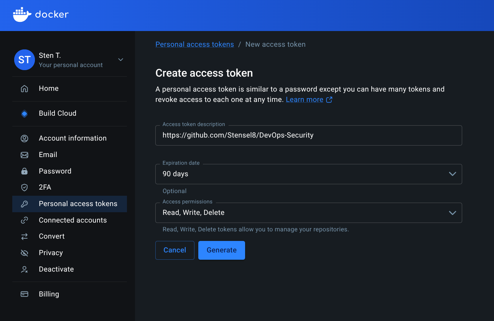
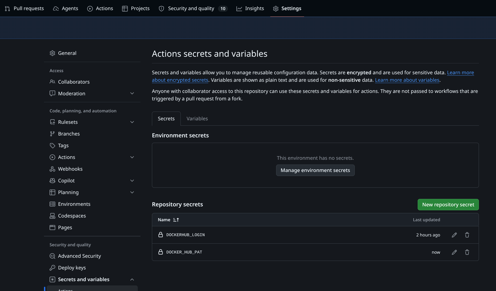
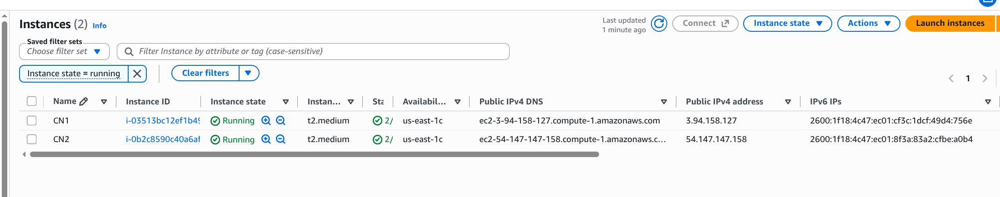
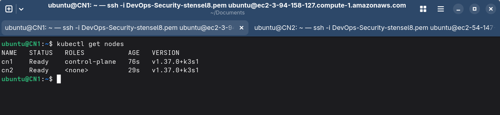
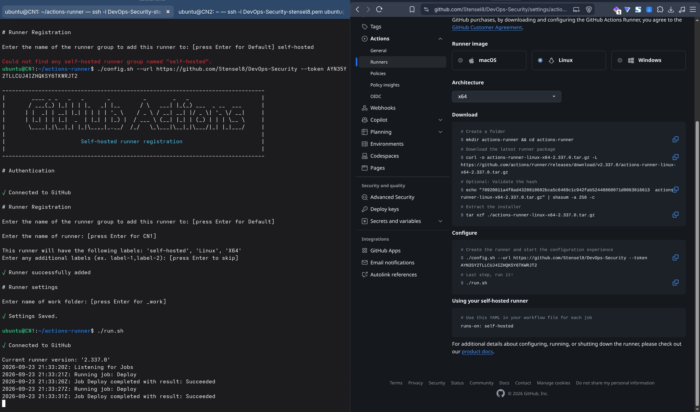
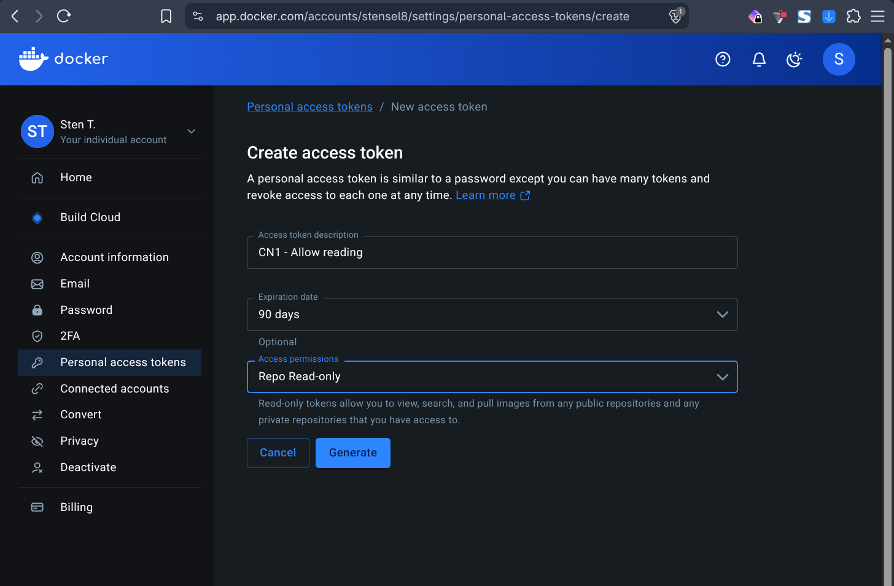
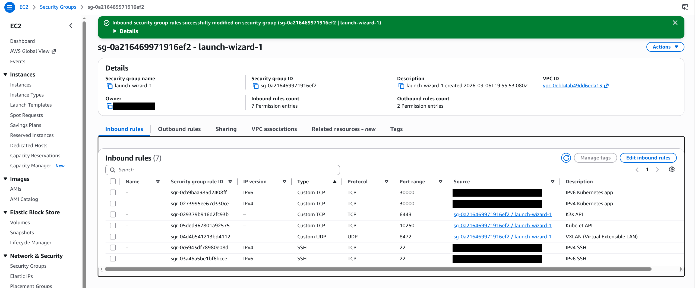
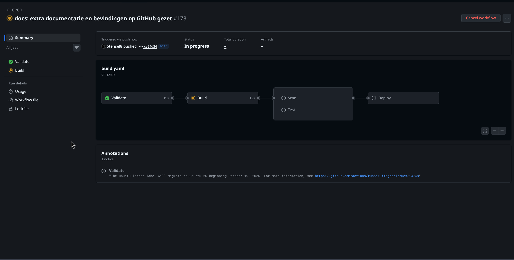

# Week 1: Testomgeving, standaarden en CVE's

In deze week staat het opzetten van de testomgeving centraal, samen met twee adviezen voor SolidApps. De testomgeving is gebouwd volgens het idee van DevOps. DevOps brengt ontwikkeling (development) en beheer (operations) samen. Teams leveren dan in kleine stappen en vaak nieuwe software op, met veel automatisering, zoals een pipeline die elke wijziging bouwt, test en uitrolt [(Microsoft, 2023)](https://learn.microsoft.com/en-us/devops/what-is-devops). Bij DevSecOps hoort security daar vanaf het begin bij, als verantwoordelijkheid van het hele team, in plaats van als controle aan het eind [(Red Hat, z.d.)](https://www.redhat.com/en/topics/devops/what-is-devsecops).

Deze week bestaat uit drie opdrachten. Paragraaf 1.1 beschrijft het opzetten van de testomgeving: twee servers met Kubernetes, een pipeline in GitHub Actions en Docker Hub voor de images. Een wijziging in de code moet daarna vanzelf op het cluster komen. Paragraaf 1.2 en 1.3 bevatten twee adviezen voor SolidApps, over standaarden en over CVE's.

## 1.1 Testomgeving

Voor de testomgeving heb ik eerst Docker Hub ingericht. Docker Hub is een registry: een online opslagplaats voor container-images, waar het cluster de images ophaalt. Ik heb daar een repository en een access token aangemaakt. Het token staat samen met de gebruikersnaam als secret in GitHub, zodat de pipeline images naar de repository kan sturen. De repository staat op private. Voor de docent zet ik hem soms tijdelijk op public.





In het AWS Learner Lab heb ik twee servers gemaakt, CN1 en CN2, met Ubuntu Server 26.04 LTS, type `t2.medium` en 15 GiB opslag. De standaard van 8 GiB is te weinig. IPv6 staat standaard uit; dat heb ik aangezet, dus beide servers hebben een IPv4- en een IPv6-adres. Na het inloggen met SSH heb ik ze bijgewerkt en de hostname gelijk gemaakt aan de naam in AWS.



Op de servers heb ik K3s geïnstalleerd. K3s is een lichte uitvoering van Kubernetes, die als één programma wordt geleverd en daardoor geschikt is voor kleine servers zoals deze. De installatie gaat met mijn eigen script [install-k3s.sh](../kubernetes/install-k3s.sh). Met `--control-plane` wordt CN1 de control plane, met `--worker` wordt CN2 de worker. Het script geeft mijn groep leesrechten op de kubeconfig, zodat `kubectl` werkt zonder `sudo`.

```bash
sudo ./install-k3s.sh --control-plane                                              # CN1
sudo ./install-k3s.sh --worker --url https://<private-ip-cn1>:6443 --token <token> # CN2
kubectl get nodes                                                                  # CN1
```



Daarna heb ik op CN1 een self-hosted runner van GitHub Actions geïnstalleerd. Een runner is de machine die de stappen van een workflow uitvoert. Normaal zijn dat servers van GitHub, maar deze runner draait op CN1 zelf, zodat hij de app rechtstreeks op het cluster kan zetten [(GitHub, z.d.-b)](https://docs.github.com/en/actions/hosting-your-own-runners/managing-self-hosted-runners/about-self-hosted-runners).



Om het image van een private repository te halen, heeft het cluster een pull secret nodig [(The Kubernetes Authors, z.d.)](https://kubernetes.io/docs/tasks/configure-pod-container/pull-image-private-registry/). Daarvoor heb ik een tweede token op Docker Hub gemaakt, met alleen leesrechten [(Docker, z.d.-a)](https://docs.docker.com/security/access-tokens/). Het staat als secret `DOCKER_HUB_PULL_PAT` in GitHub, en de pipeline maakt er bij elke uitrol het pull secret `regcred` mee aan. Zo hoeft het token niet met de hand op de server te worden ingevoerd, en staat het niet in mijn shellgeschiedenis.



Daarna heb ik de repository op private gezet en de pod verwijderd, om te controleren of het cluster het image nog kan ophalen. Zoals hieronder te zien is, start de nieuwe pod gewoon op:

```
$ kubectl delete pod -l app=quoterxp
$ kubectl get pods
student-devsecops-64fd5b7554-dzd64   1/1     Running   0          38s
```

In de security group staan alleen de poorten open die K3s nodig heeft [(K3s Project Authors, z.d.)](https://docs.k3s.io/installation/requirements), met de security group zelf als bron: TCP 6443 van de worker naar CN1, UDP 8472 voor het netwerk tussen de nodes (Flannel VXLAN) en TCP 10250 voor de kubelet. SSH (22) en de app (NodePort 30000) staan alleen open voor mijn eigen IPv4- en IPv6-adres. Bij poort 30000 was dat eerst niet zo; dat heb ik in week 5 ontdekt en rechtgezet (zie 5.2). De regels voor HTTP, HTTPS en al het verkeer binnen de groep heb ik verwijderd. Mijn IP-adressen zijn in de screenshot zwart gemaakt.



Om te laten zien dat een wijziging vanzelf op het cluster komt, heb ik een paar keer de titel van de app aangepast en weer teruggezet. Na elke push loopt de pipeline en verandert de pagina op poort 30000. Dat is te zien in de [screencast](video/live-uitrol.webm) van 10 minuten.

### De pipeline

De pipeline staat in [build.yaml](../.github/workflows/build.yaml). Validate controleert of `pyproject.toml` en `poetry.lock` kloppen en of de code compileert. Build bouwt het image (zie week 3) en stuurt het naar Docker Hub, met de tags `latest` en de commit-hash. Test start het image en wacht tot de app antwoordt. Scan controleert het image op kwetsbaarheden (zie week 3). Deploy draait op de runner op CN1. Die maakt `regcred` aan, past de Deployment en de Service toe en wacht tot de uitrol klaar is. Lukt dat niet, dan zet Deploy de vorige versie terug en wordt de pipeline rood.

De Deployment gebruikt een rolling update met een readiness probe. De oude pod blijft dan draaien tot de nieuwe klaar is, zodat de app tijdens een uitrol bereikbaar blijft.



Bij een pull request lopen alleen Validate en Build, zonder push en zonder uitrol. Met de hand starten kan alleen op `main`.

### Onder welk account draait de runner?

De runner draait als de gebruiker `ubuntu`. Die mag `sudo` zonder wachtwoord en gebruikt de kubeconfig van de beheerder van K3s. Deploy heeft dus alle rechten op CN1 en op het cluster. Voor een testopstelling is dat werkbaar, maar voor productie niet: wie de workflow kan aanpassen, kan alles op CN1 en in het cluster.

Dat geldt zeker bij een publieke repository. Wie een pull request opent, kan daarin de workflow zelf aanpassen. GitHub raadt daarom af om self-hosted runners te gebruiken voor publieke repositories [(GitHub, z.d.-a)](https://docs.github.com/en/actions/reference/security/secure-use). In mijn pipeline draait Deploy alleen op `main`, maar dat houdt een aangepaste workflow in een pull request niet tegen.

Voor productie adviseer ik SolidApps daarom:

- een eigen gebruiker voor de runner, zonder `sudo`;
- een kubeconfig die alleen Deployments en Services in één namespace mag beheren (zie week 7);
- de runner niet op de control plane laten draaien;
- de runner alleen koppelen aan een private repository, of in de instellingen eisen dat workflows van externe bijdragers eerst worden goedgekeurd.

Wel goed aan deze opzet: de runner maakt zelf een uitgaande HTTPS-verbinding met GitHub, dus er hoeft geen poort open naar internet. En het pull secret heeft alleen leesrechten.

## 1.2 Standaarden: ISO 27001, ISO 27002, NIS2 en CIS

ISO/IEC 27001 is een norm voor een managementsysteem voor informatiebeveiliging, met in bijlage A een lijst met beveiligingsmaatregelen [(International Organization for Standardization, 2022a)](https://www.iso.org/standard/27001). ISO/IEC 27002 legt per maatregel uit hoe je die kunt invullen [(International Organization for Standardization, 2022b)](https://www.iso.org/standard/75652.html).

NIS2 is een Europese richtlijn die organisaties in belangrijke sectoren verplicht om maatregelen te nemen en incidenten te melden [(Europees Parlement en Raad van de Europese Unie, 2022)](https://eur-lex.europa.eu/eli/dir/2022/2555/oj). In Nederland wordt die ingevoerd via de Cyberbeveiligingswet [(Nationaal Cyber Security Centrum, z.d.)](https://www.ncsc.nl/onderwerpen/nis2). Een hostingbedrijf als SolidApps kan daaronder vallen, als digitale dienstverlener.

De CIS Controls zijn 18 groepen technische maatregelen, op volgorde van prioriteit [(Center for Internet Security, z.d.-c)](https://www.cisecurity.org/controls/v8-1). CIS heeft ook tabellen die de controls koppelen aan ISO 27001 [(Center for Internet Security, z.d.-a)](https://www.cisecurity.org/insights/white-papers/cis-controls-v8-1-mapping-to-iso-iec-27001-2022) en aan NIS2 [(Center for Internet Security, z.d.-b)](https://www.cisecurity.org/insights/white-papers/cis-controls-v8-1-mapping-to-nis2-directive-2022-2555).

ISO 27001 en NIS2 zeggen vooral wat er geregeld moet zijn. CIS zegt wat er technisch kan, en waar je het beste kunt beginnen.

Mijn advies voor SolidApps:

1. Zoek eerst uit of SolidApps onder NIS2 valt, want dan zijn de maatregelen en de meldplicht verplicht.
2. Gebruik ISO 27001 als kader voor het hele bedrijf.
3. Gebruik de CIS Controls en de CIS Benchmarks voor Kubernetes, Docker en Ubuntu als technische basis. Een deel van die controles kan automatisch in de pipeline draaien.
4. Leg één keer vast welke NIS2-maatregel bij welke ISO- en CIS-maatregel hoort, met de tabellen van CIS als begin. Dan hoeft elke maatregel maar één keer te worden ingevuld en gecontroleerd.

## 1.3 CVE's en signature-based detectie

Een CVE is een publiek bekende kwetsbaarheid met een vast nummer [(CVE Program, z.d.)](https://www.cve.org). CVE's kun je op een paar manieren indelen:

- op ernst, met de CVSS-score: low, medium, high of critical [(FIRST, z.d.-a)](https://www.first.org/cvss/);
- op het soort zwakte, met CWE, zoals SQL-injectie of XSS [(MITRE, z.d.)](https://cwe.mitre.org);
- op de manier van aanvallen, bijvoorbeeld via het netwerk of lokaal;
- op de plek van de fout: het besturingssysteem, een package, de container runtime of Kubernetes.

Daarnaast is het belangrijk hoe dringend een CVE is. Staat hij op de KEV-lijst van CISA, dan wordt hij al echt misbruikt [(Cybersecurity and Infrastructure Security Agency, z.d.)](https://www.cisa.gov/known-exploited-vulnerabilities-catalog). De EPSS-score geeft aan hoe groot de kans is dat hij binnenkort wordt misbruikt [(FIRST, z.d.-b)](https://www.first.org/epss/).

Bij signature-based detectie vergelijkt een scanner de packages en versies in een image met databases van bekende kwetsbaarheden, zoals OSV [(OSV, z.d.)](https://osv.dev). SolidApps kan dat bij elke build in de pipeline doen, bijvoorbeeld met Docker Scout [(Docker, z.d.-b)](https://docs.docker.com/scout/) of Trivy [(Aqua Security, z.d.)](https://trivy.dev). Er komen elke dag nieuwe CVE's bij, dus ook images die al draaien moeten regelmatig opnieuw worden gescand. Het nadeel is dat zo'n scanner alleen bekende kwetsbaarheden vindt, en dus geen zero-days.

Mijn advies is om bij elke build te scannen en de build te stoppen bij een kritieke kwetsbaarheid waarvoor een oplossing bestaat, en om CVE's op de KEV-lijst of met een hoge EPSS-score als eerste op te lossen.

## Bronnen

Aqua Security. (z.d.). *Trivy*. https://trivy.dev

Center for Internet Security. (z.d.-a). *CIS Controls v8.1 mapping to ISO/IEC 27001:2022*. https://www.cisecurity.org/insights/white-papers/cis-controls-v8-1-mapping-to-iso-iec-27001-2022

Center for Internet Security. (z.d.-b). *CIS Controls v8.1 mapping to NIS2 Directive 2022/2555*. https://www.cisecurity.org/insights/white-papers/cis-controls-v8-1-mapping-to-nis2-directive-2022-2555

Center for Internet Security. (z.d.-c). *CIS Critical Security Controls version 8.1*. https://www.cisecurity.org/controls/v8-1

CVE Program. (z.d.). *CVE*. https://www.cve.org

Cybersecurity and Infrastructure Security Agency. (z.d.). *Known exploited vulnerabilities catalog*. https://www.cisa.gov/known-exploited-vulnerabilities-catalog

Docker. (z.d.-a). *Access tokens*. Docker Docs. https://docs.docker.com/security/access-tokens/

Docker. (z.d.-b). *Docker Scout*. Docker Docs. https://docs.docker.com/scout/

Europees Parlement en Raad van de Europese Unie. (2022). *Richtlijn (EU) 2022/2555 van het Europees Parlement en de Raad van 14 december 2022 betreffende maatregelen voor een hoog gezamenlijk niveau van cyberbeveiliging in de Unie (NIS 2-richtlijn)*. Publicatieblad van de Europese Unie, L 333. https://eur-lex.europa.eu/eli/dir/2022/2555/oj

FIRST. (z.d.-a). *Common Vulnerability Scoring System SIG*. https://www.first.org/cvss/

FIRST. (z.d.-b). *Exploit Prediction Scoring System (EPSS)*. https://www.first.org/epss/

GitHub. (z.d.-a). *Secure use reference*. GitHub Docs. https://docs.github.com/en/actions/reference/security/secure-use

GitHub. (z.d.-b). *Self-hosted runners*. GitHub Docs. https://docs.github.com/en/actions/hosting-your-own-runners/managing-self-hosted-runners/about-self-hosted-runners

International Organization for Standardization. (2022a). *ISO/IEC 27001:2022 Information security, cybersecurity and privacy protection: Information security management systems: Requirements*. https://www.iso.org/standard/27001

International Organization for Standardization. (2022b). *ISO/IEC 27002:2022 Information security, cybersecurity and privacy protection: Information security controls*. https://www.iso.org/standard/75652.html

K3s Project Authors. (z.d.). *Requirements*. K3s. https://docs.k3s.io/installation/requirements

Microsoft. (2023, 24 januari). *What is DevOps?* Microsoft Learn. https://learn.microsoft.com/en-us/devops/what-is-devops

MITRE. (z.d.). *CWE: Common Weakness Enumeration*. https://cwe.mitre.org

Nationaal Cyber Security Centrum. (z.d.). *Cyberbeveiligingswet (NIS2)*. https://www.ncsc.nl/onderwerpen/nis2

OSV. (z.d.). *OSV: Open source vulnerabilities*. https://osv.dev

Red Hat. (z.d.). *What is DevSecOps?* https://www.redhat.com/en/topics/devops/what-is-devsecops

The Kubernetes Authors. (z.d.). *Pull an image from a private registry*. Kubernetes. https://kubernetes.io/docs/tasks/configure-pod-container/pull-image-private-registry/
