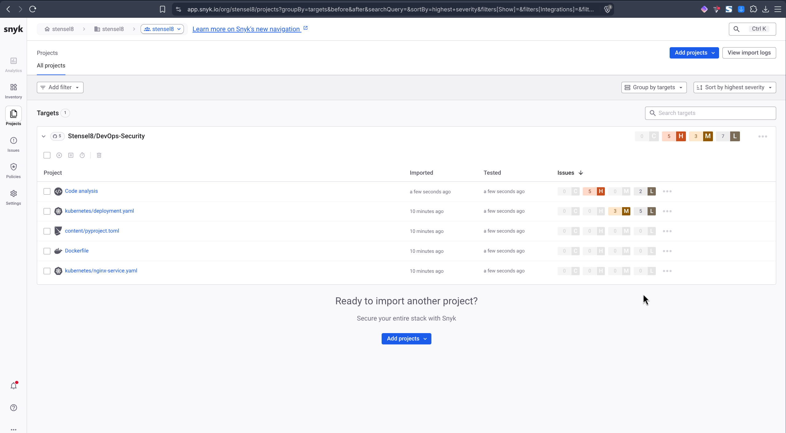
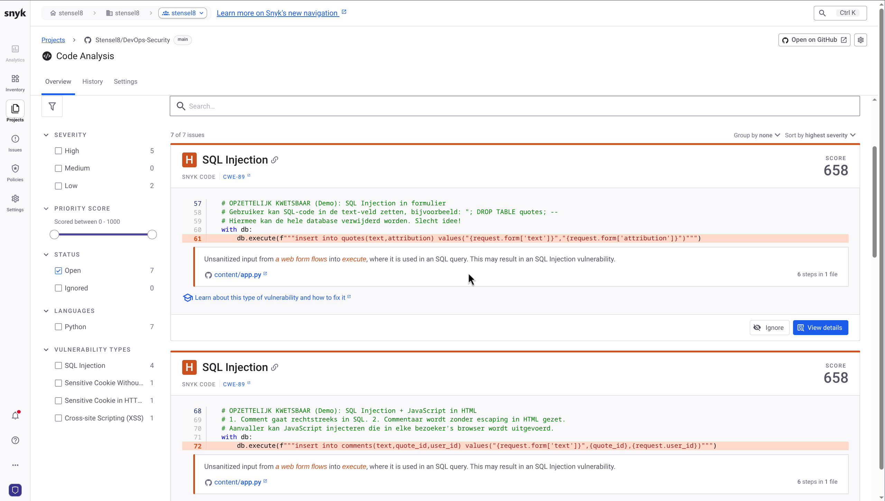
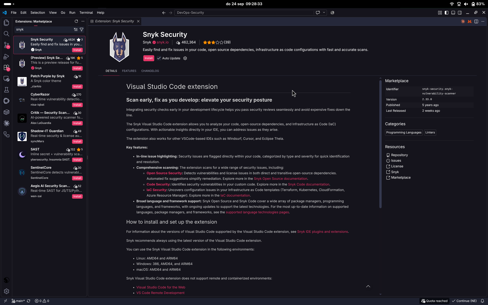
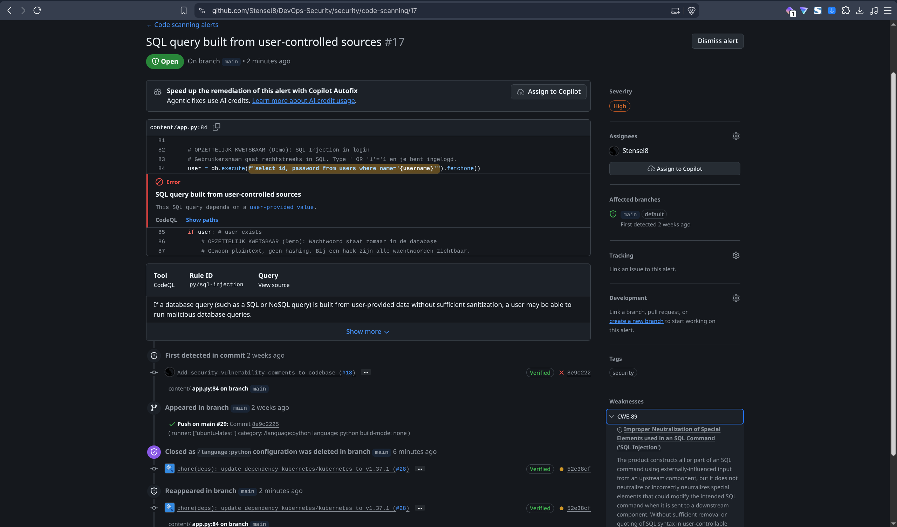
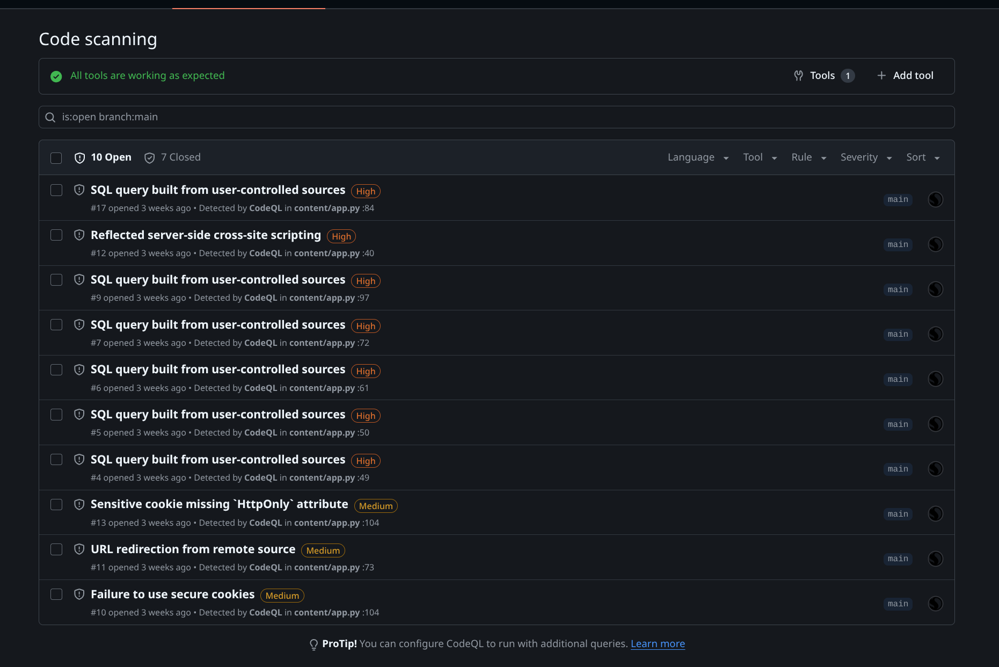
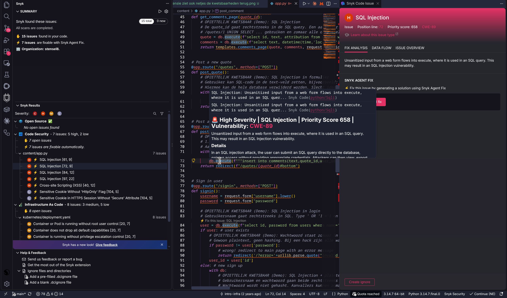
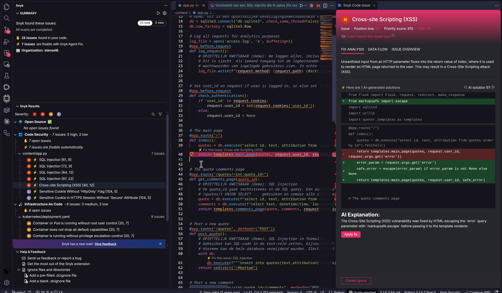
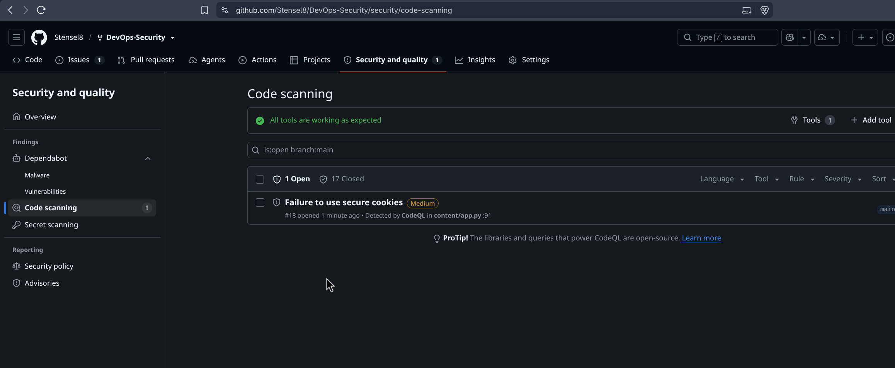
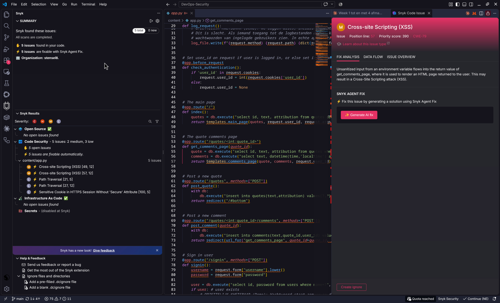

# Week 2: Snyk en veilige code

In deze week staat de beveiliging van de code zelf centraal. Een groot deel van de kwetsbaarheden zit namelijk niet in de servers of het netwerk, maar in de applicatie. Met SAST (static application security testing) wordt de broncode gecontroleerd zonder dat de applicatie draait. Zo'n scanner vindt bijvoorbeeld invoer die ongefilterd in een databasequery terechtkomt [(Snyk, 2025)](https://snyk.io/learn/application-security/static-application-security-testing/).

De twee bekendste fouten in webapplicaties zijn SQL-injectie en cross-site scripting (XSS). Tegen SQL-injectie helpen geparametriseerde queries, waarbij invoer nooit onderdeel wordt van de query zelf [(OWASP Foundation, z.d.-e)](https://cheatsheetseries.owasp.org/cheatsheets/SQL_Injection_Prevention_Cheat_Sheet.html). Tegen XSS helpt output encoding: invoer wordt zo in de pagina gezet dat de browser hem als tekst toont en niet als code uitvoert [(OWASP Foundation, z.d.-a)](https://cheatsheetseries.owasp.org/cheatsheets/Cross_Site_Scripting_Prevention_Cheat_Sheet.html).

Deze week bestaat uit drie opdrachten. Paragraaf 2.1 beschrijft de installatie van Snyk en de scan van de repository uit week 1. In paragraaf 2.2 worden de gevonden kwetsbaarheden opgelost, en paragraaf 2.3 bevat een advies voor de ontwikkelaars van SolidApps.

## 2.1 Snyk installeren en de repository scannen

Voor de opdrachten van deze week heb ik Snyk geïnstalleerd. Snyk is een platform dat software scant op kwetsbaarheden. Het bestaat uit meerdere scanners: Snyk Code controleert de eigen broncode, Snyk Open Source de gebruikte packages van anderen, en Snyk IaC configuratiebestanden zoals Kubernetes-manifests.

Ik heb Snyk gekoppeld aan mijn GitHub-account en de repository `DevOps-Security` geïmporteerd, zodat Snyk de code uit week 1 kon scannen. Als dataregio heb ik SNYK-US-01 gekozen, omdat de koppeling met GitHub niet werkte met de EU-regio. Snyk Code staat standaard uit; nadat ik het had aangezet, moest het project opnieuw worden geïmporteerd. De scan leverde de volgende resultaten op:

| Scanner | Bestand | Gevonden |
| --- | --- | --- |
| Snyk Code | `content/app.py` | Vier keer SQL-injectie ([CWE-89](https://cwe.mitre.org/data/definitions/89.html)) en één keer XSS ([CWE-79](https://cwe.mitre.org/data/definitions/79.html)), allemaal high. Twee keer low, voor de cookie zonder `HttpOnly` en zonder `Secure`. |
| Snyk IaC | `kubernetes/deployment.yaml` | Acht punten (drie medium, vijf low), onder andere geen beperking op root en geen geheugenlimiet. |
| Snyk Open Source | | Geen bevindingen. |





Daarnaast heb ik de Snyk-extensie geïnstalleerd in VS Code, de editor waarin ik programmeer. De extensie toont dezelfde kwetsbaarheden al tijdens het programmeren, met het regelnummer en uitleg.



### Extra: CodeQL in GitHub

Als extra heb ik code scanning met CodeQL aangezet. CodeQL is de scanner van GitHub zelf en is onderdeel van GitHub Advanced Security [(GitHub, z.d.-a)](https://docs.github.com/en/code-security/code-scanning/introduction-to-code-scanning/about-code-scanning-with-codeql). Elke melding laat zien wat er mis is, waar het zit, en linkt naar de beschrijving van de zwakte bij MITRE. Ook secret scanning met push protection staat aan: een push waarin een wachtwoord of token staat, wordt dan geweigerd [(GitHub, z.d.-b)](https://docs.github.com/en/code-security/secret-scanning/introduction/about-push-protection).



## 2.2 Kwetsbaarheden oplossen

Voordat ik begon met oplossen, stonden er in CodeQL tien meldingen open: zes keer SQL-injectie, één keer XSS, één keer een URL-redirect en twee keer de cookie. Fix 1 tot en met 5 gaan over deze meldingen, en fix 6 over de punten van Snyk IaC. De map `app/` heette toen nog `content/`.



### Fix 1: SQL-injectie

De app plakte invoer met een f-string in de SQL-query. Op alle zes de plekken heb ik daar geparametriseerde queries van gemaakt, met `?` als plaatshouder. Bijvoorbeeld bij het inloggen:



```diff
-    user = db.execute(f"select id, password from users where name='{username}'").fetchone()
+    user = db.execute("select id, password from users where name=?", (username,)).fetchone()
```

Voor de fix kon ik inloggen als gebruiker 1, met een wachtwoord dat ik zelf via een `UNION` meegaf. De server gaf dan de cookie `user_id=1` terug. Na de fix wordt dezelfde invoer gewoon behandeld als een gebruikersnaam, en wordt er een nieuw account aangemaakt met een eigen sessie.

### Fix 2: XSS

De app zette invoer zonder escaping in de HTML. Snyk vond alleen de variant met de parameter `error`, en stelde voor om alleen die te escapen. Ik escape in de template met `markupsafe.escape` op elke plek waar invoer in de pagina komt, zodat ook quotes, reacties, gebruikersnamen en de paginatitel veilig zijn.



Met de invoer `` is het verschil goed te zien. Voor de fix kwam de invoer letterlijk in de pagina, erna als tekst:

```
voor:  <div class=error></div>
na:    <div class=error>&lt;img src=x onerror=alert(1)&gt;</div>
```

### Fix 3: dependencies bijwerken en vastzetten

Ik heb alle dependencies bijgewerkt; Snyk Open Source vindt daarom niets. Daarnaast staat alles vast op een versie of een commit-SHA. Een tag zoals `v7` kan later naar andere code wijzen, bijvoorbeeld als het account van een maker wordt overgenomen. Een SHA kan dat niet. GitHub noemt het vastzetten op een volledige commit-SHA als manier om dat te voorkomen [(GitHub, z.d.-c)](https://docs.github.com/en/actions/reference/security/secure-use), en Docker raadt hetzelfde aan voor base images [(Docker, z.d.)](https://docs.docker.com/build/building/best-practices/). In de pipeline staat bijvoorbeeld `actions/checkout@3d3c42e5aac5ba805825da76410c181273ba90b1` in plaats van `actions/checkout@v7`.

Alle SHA's met de hand bijhouden is niet te doen. Dependabot van GitHub maakt daarom zelf een pull request zodra er een nieuwe versie is, met de nieuwe SHA erin. Zo bepaal ik zelf wanneer ik bijwerk, en draait de pipeline nooit ongemerkt andere code. Eerder gebruikte ik Renovate, dat hetzelfde doet en ook digests van Docker-images kan bijwerken [(Renovate, z.d.)](https://docs.renovatebot.com/docker/). Ik ben overgestapt naar Dependabot, zodat ik niet twee tools naast elkaar hoef te onderhouden. Een Europees alternatief dat ik volg, maar hier niet gebruik, is PatchBot van de Nederlandse stichting OpenCommit, dat is gebouwd op Renovate [(OpenCommit Foundation, z.d.)](https://opencommit.nl/en/news/patchbot/).

### Fix 4 en 5: de cookie en de redirect

De cookie `user_id` had geen `HttpOnly`, waardoor JavaScript op de pagina hem kon lezen. Met `httponly=True` en `samesite='Lax'` kan dat niet meer. Later heb ik de losse cookie vervangen door een sessie (zie de extra fixes).

CodeQL meldde daarnaast een URL-redirect, omdat `quote_id` uit de URL in de redirect terechtkwam. De URL wordt nu opgebouwd met `url_for` van Flask. Na deze fixes heeft CodeQL opnieuw gescand, en waren negen van de tien meldingen gesloten. De laatste is de `Secure`-vlag op de cookie (zie hieronder).



### Fix 6: Snyk IaC in de Deployment

Snyk IaC vond acht punten in `kubernetes/deployment.yaml`. Ik heb de container daarom beperkt: geen privilege escalation, niet als root maar als gebruiker 10001, alle capabilities weggehaald, een bestandssysteem dat alleen gelezen kan worden, een limiet op CPU en geheugen en een liveness probe. Als extra heb ik het seccomp-profiel `RuntimeDefault` toegevoegd. De belangrijkste instellingen:

```yaml
securityContext:
  runAsNonRoot: true
  runAsUser: 10001
  allowPrivilegeEscalation: false
  readOnlyRootFilesystem: true
  capabilities:
    drop: ["ALL"]
```

Een bestandssysteem dat alleen gelezen kan worden, past niet bij een app die de SQLite-database en het logbestand naast de code schrijft. Die staan nu in `/data`, een aparte map waarin wel geschreven mag worden. Bij een test op dezelfde versie van K3s als mijn cluster draaide de app als gebruiker 10001, en kon hij alleen in `/data` schrijven. Trivy vond in de manifests 19 punten vóór de fix en 3 erna.

Toen ik de Snyk-extensie opnieuw draaide, vond die nog vijf punten. Vier daarvan kwamen door mijn eigen wijziging: Snyk zag de omgevingsvariabele voor de datamap als onbetrouwbare invoer die in een pad terechtkomt. Die variabele heb ik weggehaald; de app gebruikt nu `/data` als die map bestaat. Het vijfde punt is opnieuw de `Secure`-vlag op de cookie.



### Extra fixes

Tijdens het testen vond ik nog vier problemen die geen scanner meldde:

- **Wachtwoorden in het logbestand:** het logbestand bevatte de formuliervelden, dus ook wachtwoorden. Nu worden alleen de methode en het pad gelogd.
- **Bestanden van de app te downloaden:** door `app.static_folder = '.'` kon iedereen de database en `app.py` downloaden via `/static/`. Nu is alleen de map `static/` publiek.
- **Wachtwoorden in platte tekst:** de wachtwoorden stonden leesbaar in de database. Nu worden ze opgeslagen als scrypt-hash.
- **Een aan te passen cookie:** de cookie `user_id=1` kon ik zelf aanpassen om als iemand anders in te loggen. Nu gebruikt de app de ondertekende sessie van Flask, met `HttpOnly` en `SameSite=Lax`.

### Wat nog openstaat

De `Secure`-vlag op de cookie heb ik niet gezet. Die werkt alleen met HTTPS, en de app draait nog op HTTP. Een browser bewaart een `Secure`-cookie niet via HTTP, waardoor niemand meer zou kunnen inloggen. In GitHub heb ik de melding daarom gesloten als "won't fix", met die reden erbij. Zodra er HTTPS is, met de Ingress uit week 5, kan `SESSION_COOKIE_SECURE` aan. De app heeft ook nog geen bescherming tegen CSRF en geen limiet op het aantal inlogpogingen.

## 2.3 Advies: veilig ontwikkelen in Plan en Code

SolidApps programmeert in JavaScript en C#, in Visual Studio. Microsoft beschrijft per fase van DevOps welke beveiligingsmaatregelen erbij horen, van plannen tot en met beheer [(Microsoft, 2025)](https://learn.microsoft.com/nl-nl/azure/cloud-adoption-framework/secure/devsecops-controls). Voor de fasen Plan en Code adviseer ik het volgende.

**Plan: begin met threat modeling.** Bekijk bij elke nieuwe functie met STRIDE wat er mis kan gaan, op basis van een data flow diagram [(OWASP Foundation, z.d.-f)](https://owasp.org/www-community/Threat_Modeling). Bij Quoter XP blijkt zo bijvoorbeeld dat inloggen en een quote plaatsen invoer van buiten krijgen (tampering, SQL-injectie), en dat er gebruikersgegevens worden opgeslagen (information disclosure). Bepaal daarna wat als eerste wordt aangepakt.

**Code: spreek een standaard af.** Gebruik de OWASP Top 10 als basis [(OWASP Foundation, z.d.-c)](https://owasp.org/www-project-top-ten/), de OWASP ASVS als checklist [(OWASP Foundation, z.d.-b)](https://owasp.org/www-project-application-security-verification-standard/), en de cheat sheets van OWASP per soort kwetsbaarheid. Voor SQL-injectie zijn dat geparametriseerde queries, voor XSS output encoding: precies mijn twee belangrijkste fixes. Maak daarbij drie vaste afspraken: nooit strings in een query plakken, uitvoer altijd escapen, en geen secrets in de code.

**Code: laat tools meekijken.** De Snyk-extensie bestaat ook voor Visual Studio en laat fouten zien tijdens het typen. Zet secret scanning met push protection aan, zoals in mijn repository. Laat code via een pull request met review gaan, met Snyk en CodeQL als controle, zodat een kwetsbaarheid niet ongemerkt in `main` komt. En laat Dependabot de dependencies bijhouden.

**SAST en DAST combineren.** SAST controleert de broncode zonder dat de app draait, en vindt bijvoorbeeld een f-string in `db.execute`. Dat kan vroeg, in de IDE en bij elke pull request, maar het geeft ook meldingen die niet kloppen. DAST test de draaiende applicatie van buitenaf, bijvoorbeeld met ZAP [(ZAP, z.d.)](https://www.zaproxy.org/). Dat vindt problemen in de configuratie en tijdens het draaien, maar kan pas later, en zegt niet op welke regel de fout zit. OWASP houdt een overzicht bij van tools voor broncode-analyse [(OWASP Foundation, z.d.-d)](https://owasp.org/www-community/Source_Code_Analysis_Tools). Mijn advies is SAST tijdens Plan en Code, en DAST in de testfase van de pipeline, tegen de omgeving die net is uitgerold.

## Bronnen

Docker. (z.d.). *Building best practices*. Docker Docs. https://docs.docker.com/build/building/best-practices/

GitHub. (z.d.-a). *Code scanning with CodeQL*. GitHub Docs. https://docs.github.com/en/code-security/code-scanning/introduction-to-code-scanning/about-code-scanning-with-codeql

GitHub. (z.d.-b). *Push protection*. GitHub Docs. https://docs.github.com/en/code-security/secret-scanning/introduction/about-push-protection

GitHub. (z.d.-c). *Secure use reference*. GitHub Docs. https://docs.github.com/en/actions/reference/security/secure-use

Microsoft. (2025, 24 februari). *DevOps-omgevingen beveiligen voor Zero Trust*. Microsoft Learn. https://learn.microsoft.com/nl-nl/azure/cloud-adoption-framework/secure/devsecops-controls

OpenCommit Foundation. (z.d.). *PatchBot: automated dependency updates for your repositories*. https://opencommit.nl/en/news/patchbot/

OWASP Foundation. (z.d.-a). *Cross site scripting prevention cheat sheet*. OWASP Cheat Sheet Series. https://cheatsheetseries.owasp.org/cheatsheets/Cross_Site_Scripting_Prevention_Cheat_Sheet.html

OWASP Foundation. (z.d.-b). *OWASP Application Security Verification Standard*. https://owasp.org/www-project-application-security-verification-standard/

OWASP Foundation. (z.d.-c). *OWASP Top 10*. https://owasp.org/www-project-top-ten/

OWASP Foundation. (z.d.-d). *Source code analysis tools*. https://owasp.org/www-community/Source_Code_Analysis_Tools

OWASP Foundation. (z.d.-e). *SQL injection prevention cheat sheet*. OWASP Cheat Sheet Series. https://cheatsheetseries.owasp.org/cheatsheets/SQL_Injection_Prevention_Cheat_Sheet.html

OWASP Foundation. (z.d.-f). *Threat modeling*. https://owasp.org/www-community/Threat_Modeling

Renovate. (z.d.). *Docker*. Renovate Docs. https://docs.renovatebot.com/docker/

Snyk. (2025, 13 februari). *How does SAST work? 7 stages of SAST scanning*. https://snyk.io/learn/application-security/static-application-security-testing/

ZAP. (z.d.). *ZAP*. https://www.zaproxy.org/
