# Week 3

## 3.1 SBOM

Een SBOM (Software Bill of Materials) is een lijst van alle onderdelen in een image. Per onderdeel staat erin wat het is, welke versie, welk type (bijvoorbeeld `apk` of `pypi`), de licentie en een vaste naam (`purl`). Dat staat in een standaardformaat zoals CycloneDX of SPDX, zodat een scanner het kan lezen. Een scanner vergelijkt die lijst met databases van bekende kwetsbaarheden. Komt er een nieuwe CVE bij, dan zie je met de SBOM meteen welke images het package bevatten.

Ik heb met Trivy een SBOM in CycloneDX gemaakt van het image zoals het was (commit `790a9b8^`, Debian met Poetry) en van het huidige image:

```
$ trivy image --format cyclonedx --output sbom.cdx.json <image>

# oud (Debian, Poetry in het image)
library-componenten: 272  (deb: 126, pypi: 146)
# nu (Alpine, alleen de runtime)
library-componenten: 38   (apk: 30, pypi: 8)
```

Door de andere basisimage en de multi-stage build (zie 3.2) zitten er nog 38 onderdelen in plaats van 272. Van Python zijn het alleen nog de 8 packages die de app nodig heeft: Flask, Werkzeug, Jinja2, MarkupSafe, itsdangerous, click, blinker en gunicorn. De hele SBOM staat in [sbom/devops-security.cdx.json](sbom/devops-security.cdx.json). Zo ziet één onderdeel eruit:

```json
{
  "name": "Flask",
  "version": "3.1.3",
  "purl": "pkg:pypi/flask@3.1.3",
  "licenses": [{ "license": { "id": "BSD-3-Clause" } }]
}
```

In de pipeline staat nu ook `sbom: true` bij de build-stap. Dan maakt Docker bij elke build een SBOM en zet die als attestation bij het image op Docker Hub.

## 3.2 Docker Scout

Het image in de beginstaat is kwetsbaar. Docker Scout laat 96 kwetsbaarheden zien, waarvan 3 Critical en 21 High. Het meeste zit in de basisimage (`python:3-slim-bookworm`: 3 Critical, 15 High). Mijn eigen lagen hebben ook 9 High, door `apt-get install pipx`.

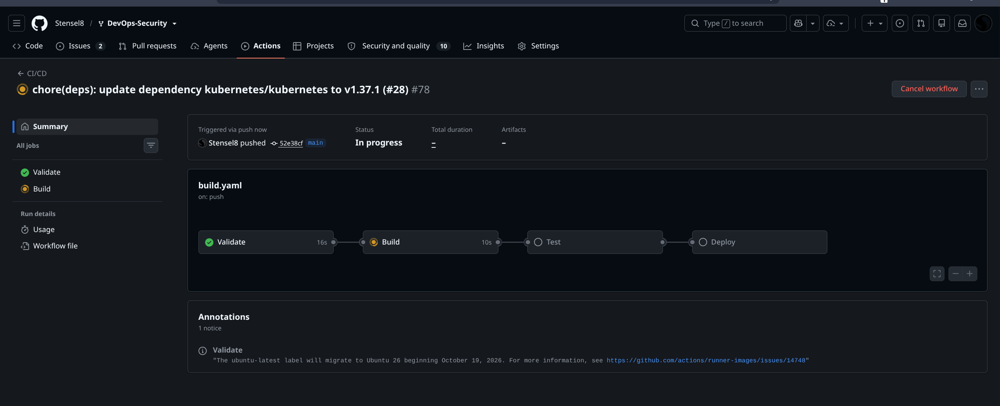

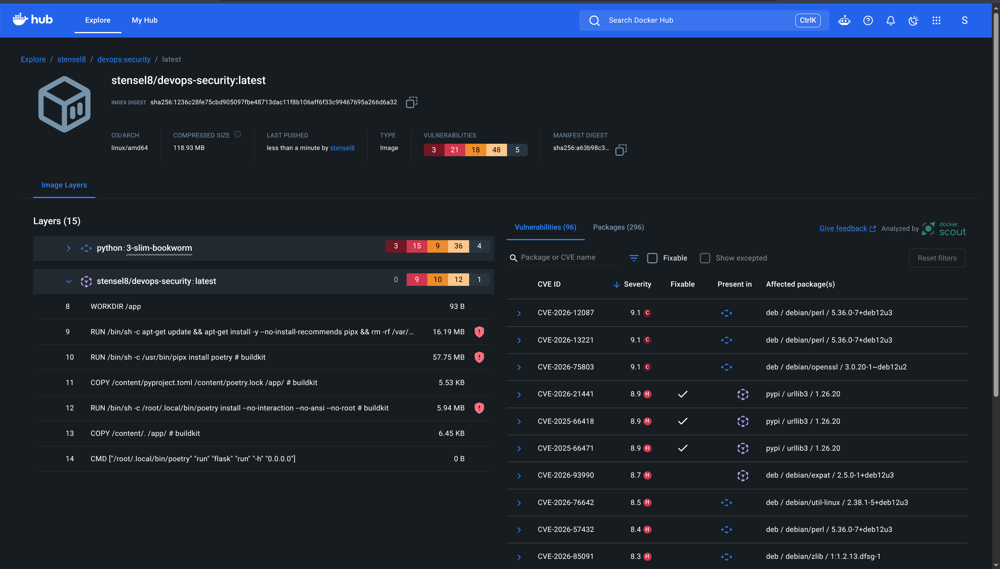

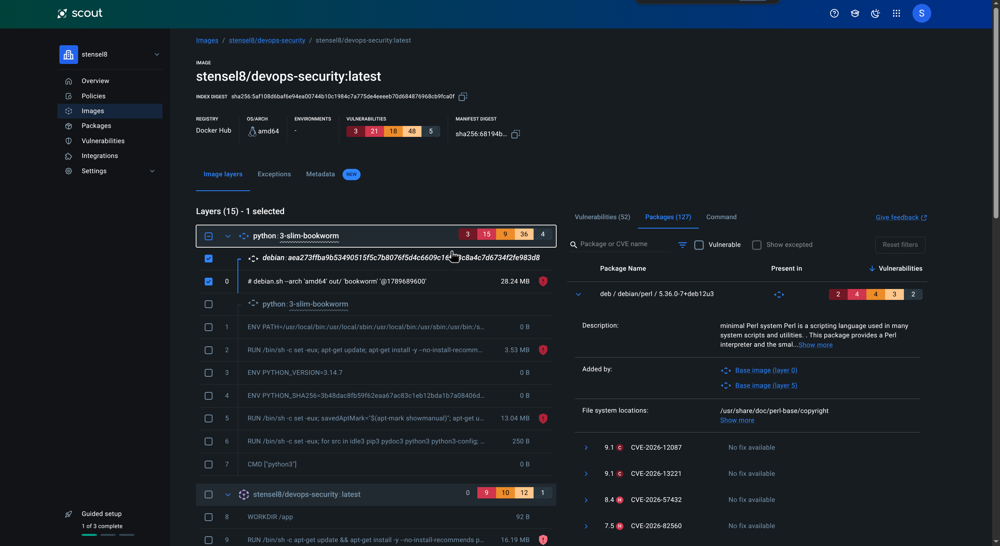

### Alle kwetsbaarheden fixen

Ik heb de Dockerfile aangepast (commit [`790a9b8`](https://github.com/Stensel8/DevOps-Security/commit/790a9b8)):

- `python:3.14-alpine` als basis in plaats van Debian.
- Het image draait als gebruiker 10001, niet als root.
- Twee stappen (multi-stage): een **builder** waarin Poetry de dependencies installeert en een **runtime** met alleen de app en de venv. Alleen de runtime gaat naar Docker Hub (`target: runtime`). Poetry en pip zitten dus niet in het image dat draait.

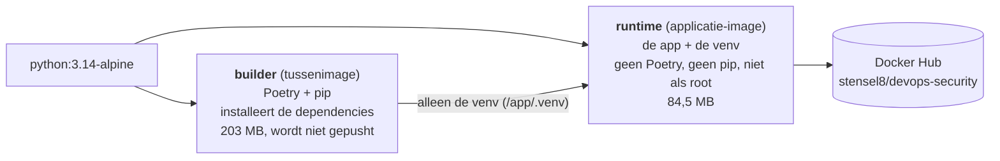

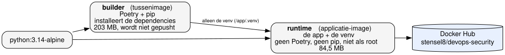

De twee `FROM`-regels in de [Dockerfile](../Dockerfile) zijn bewust: elke `FROM` begint een nieuw, schoon image. `COPY --from=builder` haalt alleen `/app/.venv` uit de builder. Pip haal ik uit de runtime, want de app heeft het niet nodig en scanners melden de gebundelde onderdelen (msgpack, setuptools). De builder draait als root, maar die stage komt niet in het image dat draait.

```dockerfile
FROM python:3.14-alpine@sha256:9e9f... AS builder
COPY app/pyproject.toml app/poetry.lock ./
RUN poetry install --no-root --only main --no-interaction --no-ansi

FROM python:3.14-alpine@sha256:9e9f... AS runtime
RUN PIP_ROOT_USER_ACTION=ignore pip uninstall -y pip
COPY --chown=10001:10001 app/ /app/
COPY --from=builder --chown=10001:10001 /app/.venv /app/.venv
USER 10001:10001
```

Ik heb Alpine gekozen. Trivy telt op de Debian-basisimage 252 kwetsbaarheden en op Alpine 3 (die komen uit pip en verdwijnen in de runtime). Trivy telt anders dan Docker Scout, want scanners gebruiken andere databases.

```
$ trivy image --scanners vuln python:3.14-slim-bookworm
Total: 252 (UNKNOWN: 2, LOW: 86, MEDIUM: 104, HIGH: 55, CRITICAL: 5)

$ trivy image --scanners vuln python:3.14-alpine
Total: 3 (UNKNOWN: 0, LOW: 0, MEDIUM: 1, HIGH: 2, CRITICAL: 0)      # uit pip
```

Trivy op mijn twee stages, lokaal gebouwd met `docker build --target builder` en `--target runtime` (getagd als `proof-builder` en `proof-runtime`):

```
$ docker images --format '{{.Repository}} {{.Size}}' | grep proof
proof-runtime 84.5MB
proof-builder 203MB

$ trivy image --severity HIGH,CRITICAL --scanners vuln proof-builder
Python (python-pkg)
Total: 2 (HIGH: 2, CRITICAL: 0)
│ msgpack    │ GHSA-6v7p-g79w-8964 │ HIGH │ fixed │ 1.1.2  │ 1.2.1  │
│ setuptools │ CVE-2025-47273      │ HIGH │ fixed │ 70.3.0 │ 78.1.1 │

$ trivy image --severity HIGH,CRITICAL --scanners vuln proof-runtime
proof-runtime (alpine 3.24.2)   alpine       0
blinker, click, flask, gunicorn, itsdangerous, jinja2, markupsafe, werkzeug   python-pkg   0
```

Docker Scout laat na de fix 0 kwetsbaarheden zien (het waren er 3 Critical, 21 High, 18 Medium en 48 Low) en 47 packages (het waren er 127).

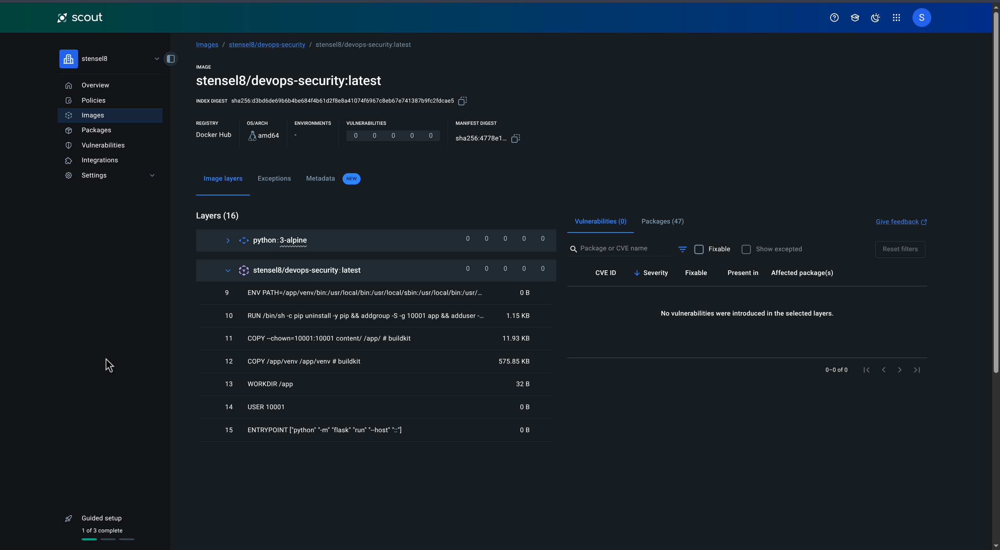

Het image is ook kleiner. Gecomprimeerd ging het van 118,93 MB naar 17 MB (zoals Docker Hub het toont), uitgepakt van ongeveer 437 MB naar 84,5 MB (lokaal gemeten, met gunicorn erbij).

Vannacht, bij de laatste build, stond er voor het eerst toch weer iets: CVE-2026-107891 in `apk/alpine/musl`, severity N/A (te nieuw om al een CVSS-score te hebben). Precies waarom dit soort scans in de pipeline blijven draaien in plaats van één keer uitgevoerd te worden: een image dat vandaag schoon is, kan morgen een nieuwe CVE in een onderliggend package hebben, zonder dat ik zelf iets aan de Dockerfile veranderd heb.

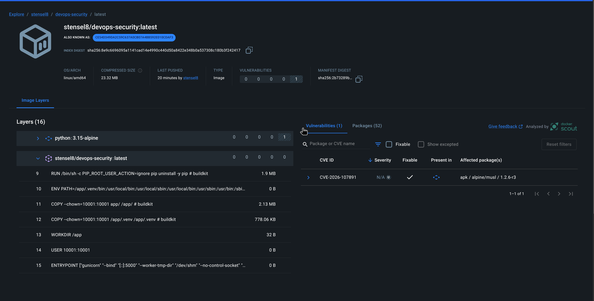

### Extra in de app

Buiten de opdracht heb ik nog drie kleine dingen aangepast. De app draait onder gunicorn in plaats van `flask run`, want dat is de ontwikkelserver ([`830426d`](https://github.com/Stensel8/DevOps-Security/commit/830426d)). Vanwege het read-only bestandssysteem staat er `--worker-tmp-dir /dev/shm` en `--no-control-socket` bij. De pagina's staan in Jinja-templates die vanzelf escapen ([`071ad02`](https://github.com/Stensel8/DevOps-Security/commit/071ad02)). Elk antwoord krijgt `X-Content-Type-Options`, `X-Frame-Options` en `Referrer-Policy` ([`8e01026`](https://github.com/Stensel8/DevOps-Security/commit/8e01026)). Daarna heb ik de app gescand met [securityheaders.com](https://securityheaders.com), de headerscanner van Snyk. Toen stonden de drie headers van hierboven er al in, en dat gaf een D, want `Content-Security-Policy` en `Permissions-Policy` ontbraken. Die heb ik toegevoegd, samen met `Cross-Origin-Opener-Policy` en `Cross-Origin-Resource-Policy` ([`e3fca00`](https://github.com/Stensel8/DevOps-Security/commit/e3fca00)). De CSP staat alleen scripts, CSS en plaatjes van de app zelf toe. Daarna gaf de scan een A. Hoger kan niet zolang de app op HTTP draait. Dat komt in week 5 met de Ingress en een certificaat.

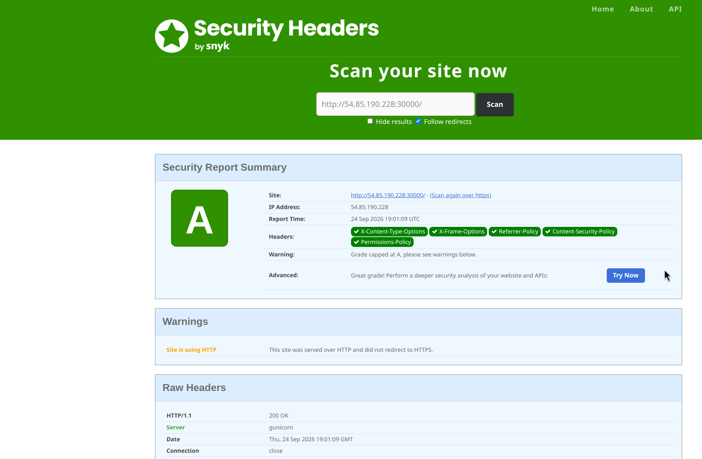

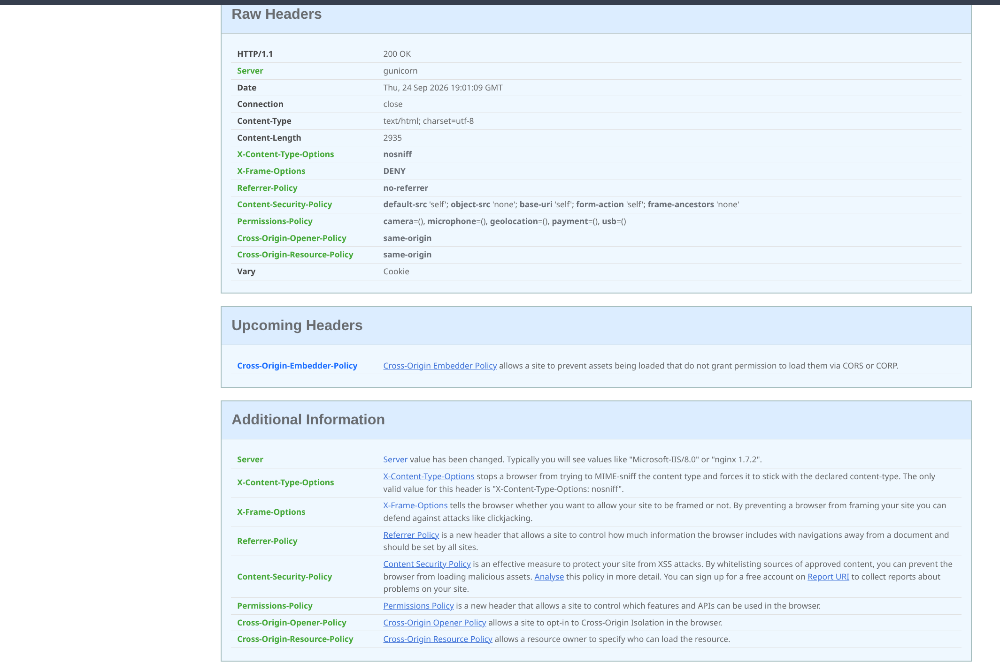

De achtergrondfoto's kwamen van `cdn.glitch.com`, maar dat domein bestaat niet meer. Ik heb ze teruggezocht op Unsplash en host ze nu zelf in `static/img/` ([`28dcc30`](https://github.com/Stensel8/DevOps-Security/commit/28dcc30)), dus de CSP hoeft geen ander domein toe te staan.

De screenshot van Docker Scout hierboven is van vóór gunicorn. Trivy geeft op het huidige image 0 kwetsbaarheden.

## 3.3 Docker Scout in de pipeline

In [build.yaml](../.github/workflows/build.yaml) staat een `scan`-job die het zojuist gepushte image met Docker Scout controleert op Critical en High kwetsbaarheden (`only-severities: critical,high`, `exit-code: true`). Deploy wacht op zowel Test als Scan (`needs: [ test, scan ]`), dus een kwetsbaar image komt niet op het cluster.

Om te laten zien dat die gate ook echt afdwingt, heb ik tijdelijk een paar dependencies teruggedraaid naar kwetsbare versies (commit [`374d9d8`](https://github.com/Stensel8/DevOps-Security/commit/374d9d8)): Flask 3.0.3, Werkzeug 3.0.3, Jinja2 3.1.4 en Gunicorn 21.2.0. Gunicorn 21.2.0 heeft twee High CVE's voor HTTP request smuggling (CVE-2024-1135 en CVE-2024-6827, CVSS 8.2 en 7.5). Scan faalde daardoor en Deploy liep niet.

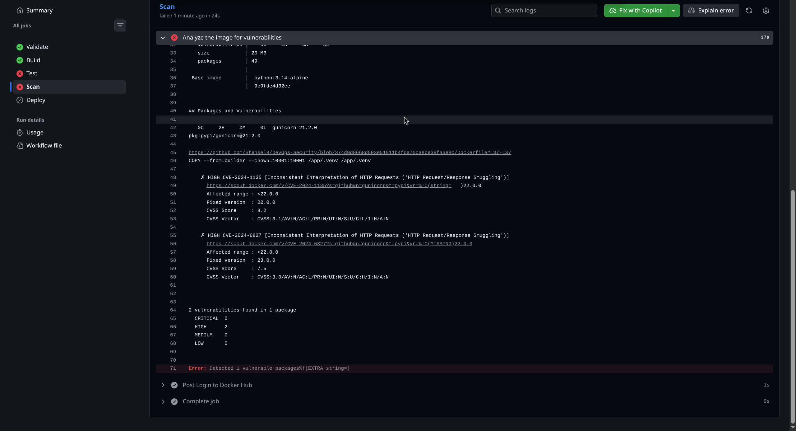

Renovate maakte voor elke kwetsbaarheid een losse pull request met het label `security`: flask (commit `5b1f0ab`, #35), gunicorn (commit `30dd48a`, #37) en jinja2 (commit `a32eb65`, #34). Na het mergen is Scan weer groen (0 kwetsbaarheden, 48 packages) en loopt Deploy door.

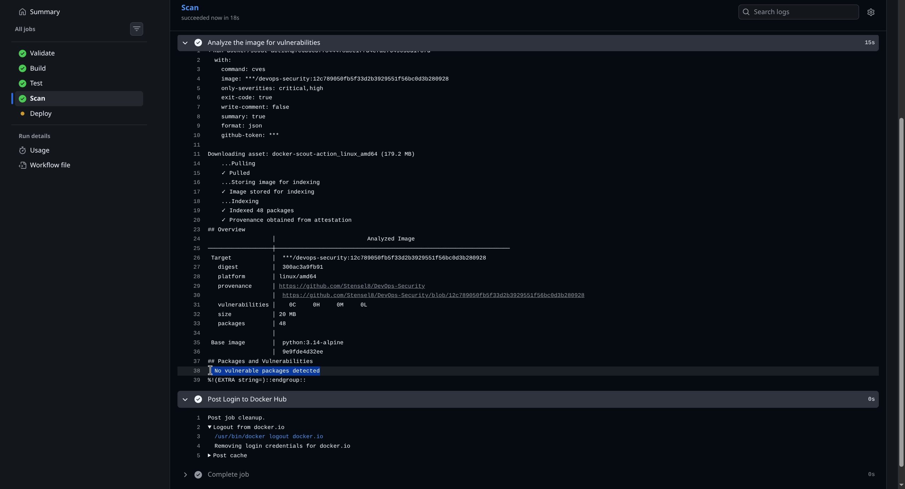

## Extra: van Poetry naar uv

Tijdens de les hadden we met z'n allen last van Python 3.12 versus 3.13 die niet lekker samenwerkten; school heeft toen de boel teruggezet naar 3.10 als workaround. Dat lost het onderliggende probleem niet op: de volgende keer dat iemand een andere Python-versie of een foute dependency-combinatie binnenhaalt, gebeurt hetzelfde weer. [uv](https://docs.astral.sh/uv/) van Astral pakt dat anders aan: het pint de exacte Python-versie en elke dependency in een lockfile (`uv.lock`), en `uv sync`/`uv run` zorgen er zelf voor dat de omgeving daarmee overeenkomt voordat er iets draait. Geen losse installatiestap meer die stil kan falen of een verkeerde versie kan pakken.

Ik heb Poetry overal vervangen door uv: `app/pyproject.toml` (alleen het `[build-system]`-blok weg, uv heeft dat niet nodig), `app/uv.lock` in plaats van `app/poetry.lock`, het Dockerfile en de `Validate`-job in de pipeline. uv zelf komt niet van pip, maar als los, gepind binary: in het Dockerfile uit het officiële `ghcr.io/astral-sh/uv`-image (op SHA gepind, zelfde patroon als de Python-basisimage), in de pipeline als gepinde release-tarball met een checksum erbij. Dependabot houdt `app/uv.lock` nu bij via het officiële `uv`-ecosystem in plaats van `pip`.

Lokaal getest, inclusief de unit tests:

```
$ cd app && uv sync --locked
Resolved 9 packages in 4ms
Installed 8 packages in 15ms

$ uv run python -m unittest discover -s ../tests -v
test_encoded_controls_cannot_forge_records ... ok
test_literal_escape_is_distinct_from_newline ... ok
test_ordinary_requests_and_secrets ... ok
Ran 3 tests in 0.441s
OK
```

En het image gewoon lokaal gebouwd en gedraaid om te checken dat de uv-versie van het Dockerfile hetzelfde doet als de Poetry-versie:

```
$ docker build --target runtime -t devops-security-uv-test .
Successfully built ...
$ docker run -d -p 8098:5000 devops-security-uv-test
$ curl -s -o /dev/null -w 'HTTP %{http_code}\n' http://localhost:8098/
HTTP 200
```

In de [screencast bij deze week](video/rollout-en-debug.webm) is ook te zien hoe dit misgaat zonder uv: ik probeer daar de Python-versie van 3.14 terug te zetten naar 3.8, en de app gaat meteen stuk. Precies het soort fout dat uv voorkomt doordat het de hele keten (interpreter + dependencies) samen vastlegt in plaats van los van elkaar.

## 3.4 Testsoorten in de testfase

In de pipeline draaien nu drie soorten tests, elk op een ander niveau. De `validate`-job draait de unit tests (`tests/test_access_log.py`), die testen één functie geïsoleerd, met een tijdelijke map en een gemockte `os.path.isdir`. Die lopen op elke commit, zijn snel en hebben niks gebouwd of gedeployed nodig. De `test`-job doet een smoke test: start het net gebouwde image en wacht tot het antwoordt op HTTP. Dat test niet de logica, alleen of het image uberhaupt opstart. Een kapotte dependency of een verkeerd entrypoint vangt dit, een logicafout niet. En de `scan`-job is eigenlijk geen functionele test maar een gate in de testfase: die scant het image tegen een kwetsbaarhedendatabase in plaats van tegen mijn eigen testcode.

Wat er nog ontbreekt is een echte integratietest die een scenario doorloopt zoals inloggen, een quote plaatsen en die terugzien (3.5/3.6 pakken dat met Postman), en een DAST-scan tegen de draaiende app (bijvoorbeeld OWASP ZAP), die van buitenaf test in plaats van de code te lezen. Ik zou dat na Deploy laten lopen, tegen de net uitgerolde omgeving, zodat het ook misconfiguraties in Kubernetes zelf raakt en niet alleen de applicatiecode.

## Extra: CodeRabbit

Naast Snyk, CodeQL en Trivy heb ik CodeRabbit aan de repository gekoppeld (issue [#39](https://github.com/Stensel8/DevOps-Security/issues/39)), een AI-codereview bovenop de bestaande scanners. Ik heb de 14 dagen gratis trial gebruikt; CodeRabbit is daarna een betaald product en ik heb het abonnement niet aangehouden. De instellingen staan wel vast in [`.coderabbit.yaml`](../.coderabbit.yaml), voor het geval ik het later weer aanzet.

Het meest interessante wat CodeRabbit deed, deed het volledig uit zichzelf: de "coding agent"-functie scande de repository, vond dat `request.path` ongefilterd in het logbestand terechtkwam (dezelfde soort kwetsbaarheid als bij de wachtwoorden-in-het-logbestand uit week 2, maar dan log-injectie: een pad met een newline erin zou een nep-logregel kunnen forceren), en opende zelf [PR #41](https://github.com/Stensel8/DevOps-Security/pull/41) met een fix én regressietests. Ik heb er niet om gevraagd en ook geen review aangevraagd; CodeRabbit deed dit proactief en autonoom, met zijn eigen GitHub-account als auteur.

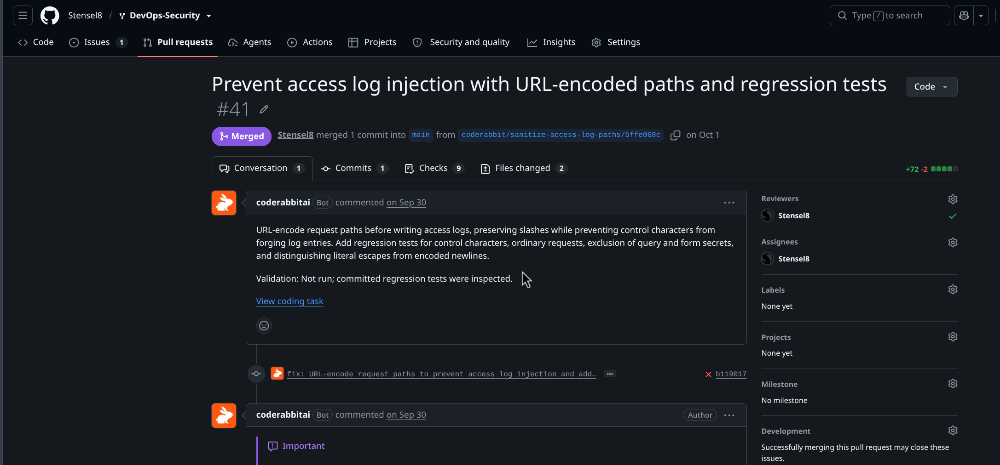

Ik heb de PR beoordeeld en gemerged (commit [`e7bc5f0`](https://github.com/Stensel8/DevOps-Security/commit/e7bc5f0)):

```diff
@@ app/app.py:36-38 @@
 def log_request():
-    log_file.write(f"{request.method} {request.path}\n")
+    # URL-encoding voorkomt dat control-tekens in het pad extra logregels maken.
+    log_path = urllib.parse.quote(request.path, safe="/")
+    log_file.write(f"{request.method} {log_path}\n")
```

Plus 68 regels nieuwe tests in `tests/test_access_log.py`, die onder andere controleren dat control-tekens geen nieuwe logregel kunnen forceren en dat een gewoon verzoek er nog normaal uitziet. Die tests draaien sindsdien gewoon mee in de `validate`-job van de pipeline.

## 3.5 en 3.6 Postman-tests in de pipeline

De collectie staat in [tests/postman/quoter-xp.postman_collection.json](../tests/postman/quoter-xp.postman_collection.json), met twee requests. De eerste is de verplichte test uit 3.5: de homepage geeft HTTP 200 en de tekst "Quoter XP" staat in de body. De tweede (3.6) test iets dat een scanner niet checkt: staan de security-headers uit week 3 er nog op, en draait de app echt op gunicorn in plaats van de Flask-ontwikkelserver (`flask run`), die niet voor productie bedoeld is en geen van die headers vanzelf zou zetten.

In de `Test`-job van [build.yaml](../.github/workflows/build.yaml) start ik eerst de container van het net gebouwde image (zoals de bestaande smoke test al deed), en laat die nu ook staan voor Newman, de command-line runner van Postman. GitHub-runners hebben Node.js al staan, dus `npx newman` hoeft niets extra's te installeren:

```yaml
- name: Run the Postman tests
  run: npx --yes newman run tests/postman/quoter-xp.postman_collection.json --env-var baseUrl=http://localhost
```

Lokaal getest tegen hetzelfde image (gebouwd uit de huidige Dockerfile, gedraaid met Newman via Docker):

```
$ docker run -d --name quoterxp-test -p 8099:5000 devops-security-test:local
$ docker run --rm --network host -v "$PWD/tests/postman:/etc/newman" postman/newman:alpine \
    run quoter-xp.postman_collection.json --env-var baseUrl=http://localhost:8099

→ Homepage antwoordt met 200 en Quoter XP
  GET http://localhost:8099/ [200 OK, 3.54kB, 32ms]
  ✓  status is 200
  ✓  body bevat Quoter XP

→ Security headers staan erop
  GET http://localhost:8099/ [200 OK, 3.54kB, 6ms]
  ✓  X-Content-Type-Options is nosniff
  ✓  X-Frame-Options is DENY
  ✓  Content-Security-Policy staat erop
  ✓  draait op gunicorn, niet op de Flask-ontwikkelserver

  assertions: 6, failed: 0
```

En bevestigd in de echte `Test`-job van de pipeline, tegen het net gebouwde image op de GitHub-runner:

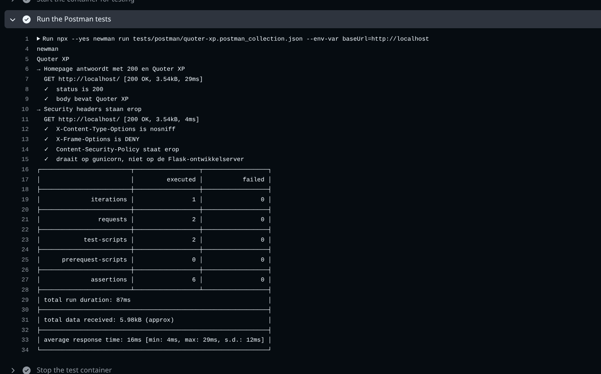

## 3.7 Advies: veilige images en teststrategie

Voor SolidApps zou ik dezelfde opbouw aanhouden die nu in deze pipeline staat, als vast proces per build:

1. Build met een minimale, recente basisimage (Alpine i.p.v. een volledige distro), multi-stage zodat buildtools (Poetry, pip, compilers) niet in het image komen dat draait, en nooit als root.
2. SBOM genereren bij elke build (Docker's `sbom: true` of een losse Trivy/Syft-stap), zodat bij een nieuwe CVE meteen duidelijk is welke images die bevatten.
3. Image-scan vóór de deploy, met een harde gate op Critical/High (Docker Scout of Trivy). Geen uitzonderingen: een kwetsbaar image mag niet uitgerold worden, ook niet "tijdelijk".
4. Unit tests en een smoke test op elke build, Postman/Newman-tests tegen de draaiende container voor het functionele en security-gedrag (headers, verwachte content), en een DAST-scan (bijvoorbeeld OWASP ZAP) tegen de net uitgerolde omgeving.
5. SAST en dependency-scanning (Snyk, CodeQL, Trivy) op elke pull request, zodat een kwetsbaarheid niet eerst naar `main` hoeft voor hij opvalt. CodeRabbit erbij voor codekwaliteit, als extra laag naast de securityscanners.

Tooling-advies: Docker Scout of Trivy voor images, Snyk of CodeQL voor code, Postman/Newman voor functionele en security-checks in de pipeline, en OWASP ZAP voor DAST. Voor SolidApps, die met meerdere talen werkt (JavaScript, C#), is het vooral belangrijk dat deze stappen taal-onafhankelijk in de pipeline staan en niet per project opnieuw ingericht hoeven te worden.
