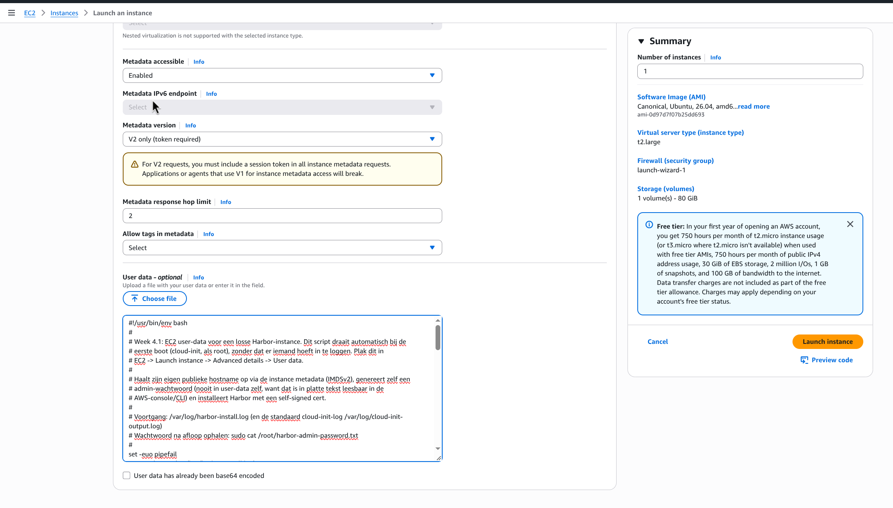
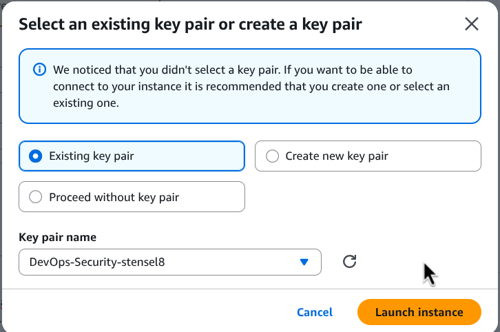
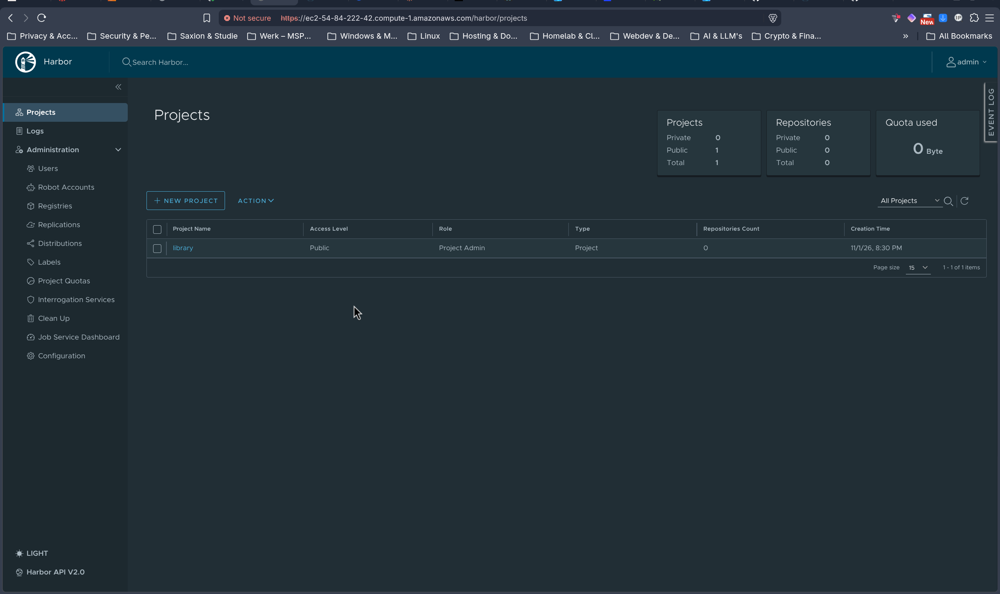
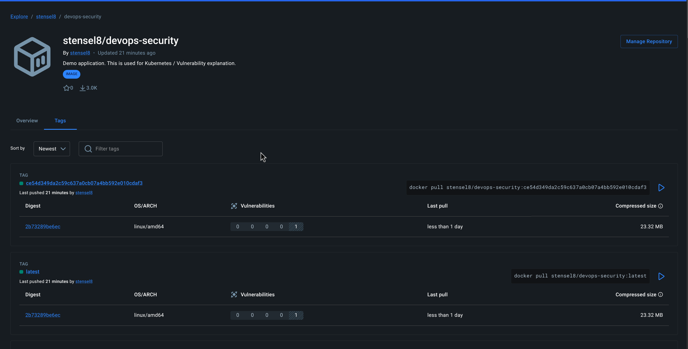
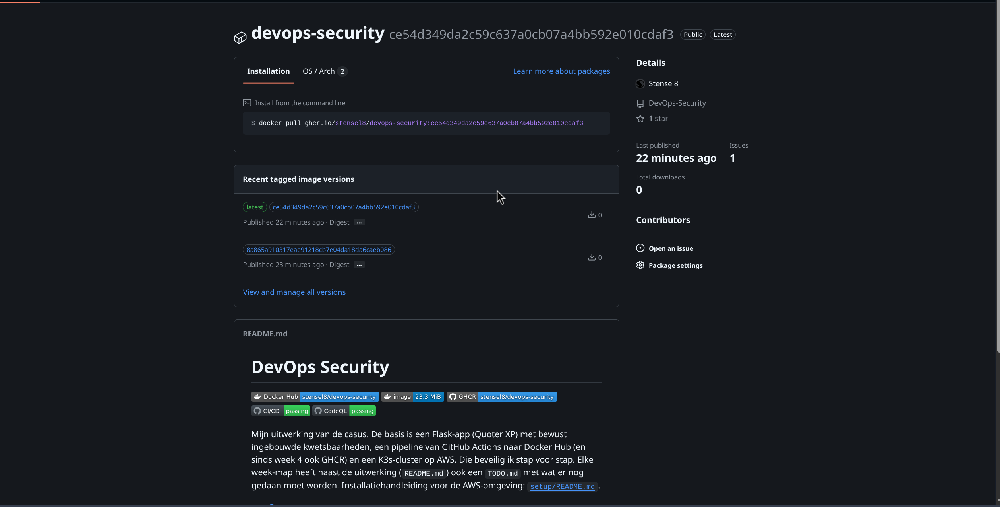
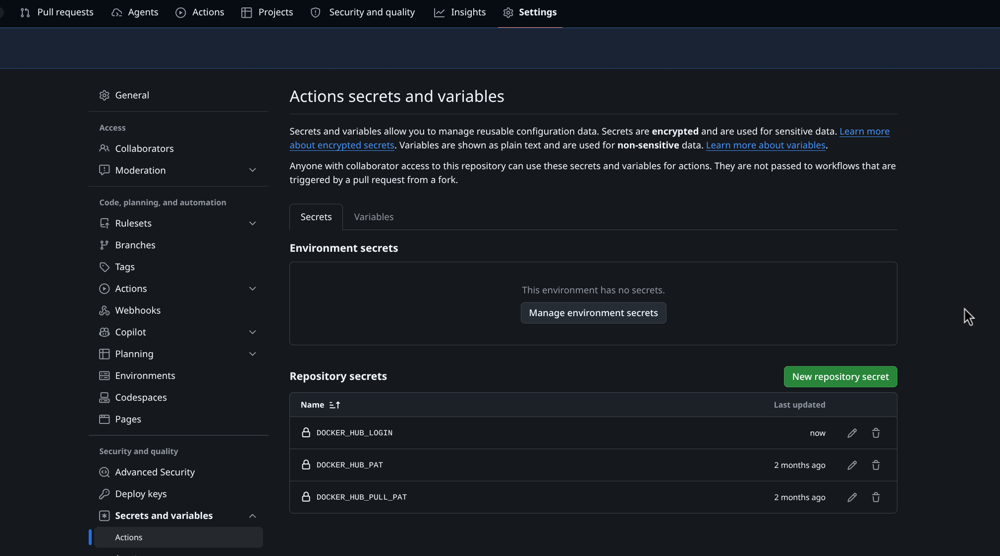

# Week 4

## 4.1 Eigen Harbor-registry

Een losse EC2-instance (`t2.large`, Ubuntu 26.04, zelfde sleutelpaar als CN1/CN2) naast het K3s-cluster, want Harbor's eigen docker-compose-stack (registry, portal, core, redis, postgres) wil niet concurreren met K3s op een al kleine `t2.medium`.





Geïnstalleerd via een EC2 user-data-script ([kubernetes/harbor/harbor-userdata.sh](../kubernetes/harbor/harbor-userdata.sh)) dat zichzelf bij de eerste boot installeert: Docker, een self-signed TLS-certificaat op de eigen publieke hostname (opgezocht via de instance-metadata, IMDSv2), en de Harbor offline-installer. Het admin-wachtwoord genereert het script zelf en zet het lokaal in `/root/harbor-admin-password.txt` weg, nooit in de user-data zelf (die is in platte tekst leesbaar via de AWS-console/CLI).

Eerste versie van het script bleef hangen: het riep `cloud-init status --wait` aan om op het netwerk te wachten, maar draait zelf al als onderdeel van cloud-init's laatste module, dus wachtte op zichzelf. Gefixt door die regel te laten vervallen (user-data draait toch al pas na de netwerk-stap van cloud-init).

Na de install: ingelogd op `https://ec2-54-84-222-42.compute-1.amazonaws.com` met het gegenereerde wachtwoord.



## Extra: het image ook naar GitHub Container Registry

Naast Docker Hub pusht de `Build`-job nu ook naar GHCR (`ghcr.io/stensel8/devops-security`), met dezelfde `latest`- en commit-SHA-tags. Dat staat los van 4.1-4.4, maar sluit er wel op aan: het laat zien hoe makkelijk het is om een image op twee registries tegelijk te zetten, precies het soort afweging dat in 4.3 aan bod komt.

GHCR gebruikt hier geen los PAT zoals Docker Hub (4.2), maar de ingebouwde `GITHUB_TOKEN` van de workflow-run zelf, met `packages: write` alleen voor de `Build`-job:

```yaml
permissions:
  contents: read
  packages: write   # alleen voor deze job, de rest van de pipeline blijft contents: read

steps:
  - name: Login to GitHub Container Registry
    uses: docker/login-action@81c6f93d4bc991e510b342a00b419b3bb4efc5c6 # v4
    with:
      registry: ghcr.io
      username: ${{ github.actor }}
      password: ${{ secrets.GITHUB_TOKEN }}
```

Dat token is automatisch per workflow-run aangemaakt en verloopt vanzelf zodra de job klaar is: nog korter levend dan de PAT's uit 4.2, en er hoeft niets handmatig aangemaakt of in GitHub secrets gezet te worden.

Het image staat zo op twee plekken, met dezelfde inhoud. Docker Hub:



En GHCR, inclusief dezelfde README die Docker Hub ook toont:



## 4.2 Docker Hub-login met een PAT

Dit stond al vanaf week 1 goed: de pipeline logt in met een Personal Access Token, nooit met het wachtwoord van mijn Docker Hub-account. Er zijn zelfs twee tokens met een verschillend doel, zie [week-1/README.md](../week-1/README.md#11-bootomgeving): `DOCKER_HUB_PAT` (lezen en schrijven, voor de `Login to Docker Hub`-stappen die pushen) en `DOCKER_HUB_PULL_PAT` (alleen lezen, voor het `regcred`-pull-secret dat de Deploy-job op het cluster zet).

Een wachtwoord geeft volledige toegang tot het account en moet overal hetzelfde blijven. Een PAT is beperkt tot API/registry-toegang, kan los van het wachtwoord ingetrokken worden zonder dat ik opnieuw moet inloggen op elke plek waar het wachtwoord stond, en kan je per token zien wanneer hij voor het laatst gebruikt is. Komt een token toch ergens in een log terecht, dan intrek ik alleen dat token. Met een wachtwoord zou ik overal opnieuw moeten inloggen, inclusief 2FA. Dat de pull-token alleen leesrechten heeft is least privilege: komt die ooit uit op CN1, dan kan daarmee niemand naar mijn repository pushen.

De secret-naam voor de gebruikersnaam heette eerst `DOCKERHUB_LOGIN` (geen underscore tussen Docker en Hub), terwijl de twee tokens wel `DOCKER_HUB_PAT` en `DOCKER_HUB_PULL_PAT` heten. Hernoemd naar `DOCKER_HUB_LOGIN` voor consistentie (GitHub kan een secret niet hernoemen, dus nieuwe aangemaakt met dezelfde waarde en de oude verwijderd), en `build.yaml` op de vier plekken aangepast waar die secret gebruikt wordt.



## 4.3 Registry-vergelijking: ECR, ACR en Docker Hub

| | Docker Hub | AWS ECR | Azure ACR |
| --- | --- | --- | --- |
| Security | PAT's, geen IAM-koppeling. Secret scanning alleen via losse tools | IAM-rollen, OIDC vanuit de pipeline mogelijk (geen statische sleutels), scanning via Inspector | Entra ID/RBAC, managed identities vanuit AKS (ook geen statische sleutels), scanning via Defender for Cloud |
| Kosten | Gratis voor publieke images, rate limits op het gratis plan (pull-limiet per 6 uur) | Betaal naar gebruik (opslag + dataverkeer), geen aparte abonnementskosten | Zelfde model als ECR, drie tiers (Basic/Standard/Premium) voor meer opslag/geo-replicatie |
| Performance | Rate limits kunnen een pipeline vertragen of laten falen bij veel builds | Laag, binnen dezelfde AWS-regio als het cluster | Laag, binnen dezelfde Azure-regio als het cluster |

Voor SolidApps, die voor klanten op Azure en AWS draait, zou ik Docker Hub alleen gebruiken voor publieke, niet-gevoelige images (zoals in deze PoC) en voor de rest ECR of ACR kiezen, afhankelijk van de cloud waar de workload draait. Het belangrijkste verschil met Docker Hub is dat beide clouds pushen/pullen laten verifiëren met identiteiten die de cloud zelf al beheert (IAM-rol of managed identity), in plaats van een los PAT dat ergens in een GitHub secret moet staan.

Harbor (4.1) heeft geen eigen cloud-identiteitsprovider, maar ondersteunt wel OIDC. Met Entra ID als OIDC-provider ingesteld, loggen gebruikers en pipelines in met hun Entra ID-identiteit in plaats van een los Harbor-account, en worden Entra ID-groepen gekoppeld aan Harbor-projectrollen (guest/developer/maintainer). Dat is dezelfde federatie-gedachte als mijn advies in week 2 (2.3) voor de AWS-console: één centrale identiteit, geen losse wachtwoorden per systeem.

## 4.4 De Docker Hub secrets-lek van december 2025

Flare publiceerde op 10 december 2025 onderzoek naar 10.456 publieke Docker Hub-images (geüpload in november 2025) met minstens één geëxporteerd secret erin. Dit was geen hack van Docker zelf: gebruikers hadden zelf levende cloud-sleutels, GitHub-tokens en CI/CD-credentials in hun images gebakken, onder andere via manifests. Het ging om meer dan 100 bedrijven, waaronder een Fortune 500-bedrijf en een grote bank, via een persoonlijk publiek account. Van de getroffen developers haalde ongeveer een kwart het secret binnen 48 uur uit de image, maar ongeveer driekwart draaide de onderliggende sleutel zelf niet om: het secret was weg uit de image, maar bleef bruikbaar.

Onze eigen PoC bakt geen secrets in het image. De `app.secret_key` wordt bij het opstarten willekeurig gegenereerd (`secrets.token_hex(32)` in `app.py`), niet in een bestand gezet. Er wordt niets met `COPY` uit een `.env`- of configbestand met echte waardes in het image gezet, en de Docker Hub- en Kubernetes-credentials komen via GitHub secrets binnen, nooit als bestand in de repository of het image (zie de comments "NOOIT hardcoded!" in [build.yaml](../.github/workflows/build.yaml)). [trivy.yml](../.github/workflows/trivy.yml) scant de repository op commits met secrets erin (`scanners: vuln,misconfig,secret`), maar dat scant de broncode, niet de lagen van het gebouwde image zelf.

Advies voor SolidApps:

1. Nooit secrets met `COPY` of `ENV` in een Dockerfile zetten, ook niet in een tussenstap van een multi-stage build: elke laag blijft bewaard, ook na een latere `RUN rm`.
2. Secrets altijd runtime injecteren: Kubernetes Secrets, environment variables vanuit de CI-runner, of een secrets manager (bijvoorbeeld AWS Secrets Manager of Azure Key Vault).
3. Naast het scannen van de broncode (zoals Trivy nu doet) ook het gebouwde image zelf op secrets scannen vóór de push, zodat een per ongeluk meegekopieerd configbestand er niet doorheen glipt.
4. Een vaste procedure voor als het toch misgaat: niet alleen het secret uit de image/repository halen, maar de onderliggende sleutel altijd ook daadwerkelijk intrekken en vervangen. Dat is precies waar driekwart van de getroffen developers in het Flare-onderzoek het liet zitten.
5. Geen gevoelige images op een persoonlijk, publiek Docker Hub-account. Voor SolidApps: een eigen organisatie-account met private repositories, of zoals bij 4.1 een eigen Harbor-registry voor interne images.

**Bronnen**

- Flare Systems, Inc. (2025). *Thousands of exposed secrets found on Docker Hub, putting organizations at risk*. [https://flare.io/learn/resources/docker-hub-secrets-exposed](https://flare.io/learn/resources/docker-hub-secrets-exposed)
- The Register. (2025, 11 december). *10K Docker images spray live cloud creds across the internet*. [https://www.theregister.com/2025/12/11/docker_hub_secrets_leak/](https://www.theregister.com/2025/12/11/docker_hub_secrets_leak/)
- BleepingComputer. (2025). *Over 10,000 Docker Hub images found leaking credentials, auth keys*. [https://www.bleepingcomputer.com/news/security/over-10-000-docker-hub-images-found-leaking-credentials-auth-keys](https://www.bleepingcomputer.com/news/security/over-10-000-docker-hub-images-found-leaking-credentials-auth-keys)
