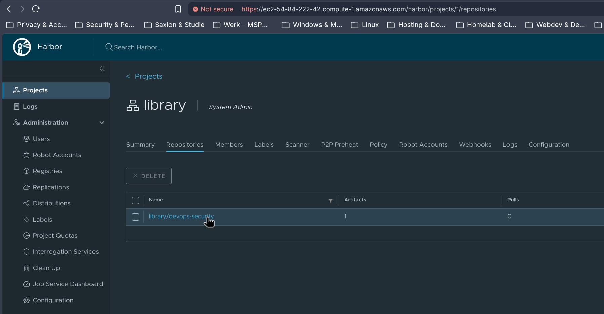
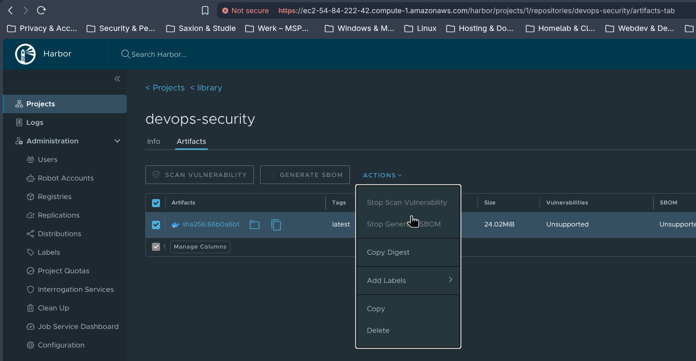

# Week 4: Registry-beveiliging

In deze week staat de registry centraal: de plek waar container-images worden opgeslagen en vanwaar het cluster ze ophaalt. Een registry is een aantrekkelijk doelwit. Wie een image in de registry kan aanpassen, kan eigen code laten draaien op elk cluster dat dat image gebruikt. En wie een image kan downloaden, kan alles lezen wat erin staat, ook gegevens die er per ongeluk in terecht zijn gekomen.

Bij de beveiliging van een registry gaat het daarom vooral om twee vragen: wie mag images pushen en pullen, en hoe bewijst iemand of iets wie hij is. In plaats van een wachtwoord kan dat met een access token met beperkte rechten [(Docker, z.d.-a)](https://docs.docker.com/security/access-tokens/), of met een identiteit die het cloudplatform zelf beheert.

Deze week bestaat uit vier opdrachten. Paragraaf 4.1 beschrijft de installatie van een eigen registry met Harbor. Paragraaf 4.2 licht toe waarom de pipeline inlogt met een access token, en paragraaf 4.3 vergelijkt de registries van AWS, Azure en Docker Hub. Paragraaf 4.4 bespreekt het lek van secrets op Docker Hub uit december 2025. Als extra staat het image sinds deze week ook in GitHub Container Registry.

## 4.1 Eigen Harbor-registry

Voor deze opdracht heb ik Harbor geïnstalleerd. Harbor is een open-source registry die je zelf kunt hosten, met projecten, gebruikersrechten en ondersteuning voor verschillende manieren van inloggen [(Harbor, z.d.-c)](https://goharbor.io/docs/2.13.0/administration/configure-authentication/). Zo blijven interne images binnen de eigen omgeving.

Harbor draait op een aparte server naast het cluster, met Ubuntu 26.04 en type `t2.large`. Harbor bestaat zelf uit meerdere containers, zoals de registry, de webinterface, een database en een cache. Op de kleine `t2.medium`-servers van het cluster zou dat met K3s om dezelfde geheugenruimte concurreren.


De installatie gaat volledig automatisch, met het script [kubernetes/harbor/harbor-userdata.sh](../kubernetes/harbor/harbor-userdata.sh). Dat script draait bij de eerste start van de server en voert de volgende stappen uit:

- **Docker installeren:** Harbor draait zelf in containers.
- **Een TLS-certificaat maken:** het script zoekt de publieke hostnaam van de server op en maakt daarvoor een self-signed certificaat, zodat Harbor alleen via HTTPS bereikbaar is [(Harbor, z.d.-a)](https://goharbor.io/docs/2.13.0/install-config/configure-https/).
- **Harbor installeren:** met de offline-installer van Harbor.
- **Een beheerderswachtwoord maken:** het script maakt zelf een willekeurig wachtwoord aan en bewaart het op de server in `/root/harbor-admin-password.txt`, alleen leesbaar voor root. Het wachtwoord staat dus niet in het script zelf, want user data is via de AWS-console en de CLI in platte tekst te lezen.

De eerste versie van het script bleef hangen. Het wachtte met `cloud-init status --wait` tot de server klaar was met opstarten, maar het script is zelf een onderdeel van die opstartfase, en wachtte dus op zichzelf. Zonder die regel werkt het wel, omdat user data pas draait als het netwerk al klaar is.

Na de installatie heb ik ingelogd met het gegenereerde wachtwoord.


Om te controleren dat pushen en pullen werkt, heb ik het image van Docker Hub opgehaald, naar Harbor gepusht, lokaal verwijderd en weer uit Harbor gehaald. Docker vertrouwt het self-signed certificaat van Harbor via `/etc/docker/certs.d/<host>/ca.crt`. Dat heb ik op de Harbor-server zelf ingesteld, omdat dat op mijn eigen laptop vastliep op een probleem met de rechten.

```
$ docker push ec2-54-84-222-42.compute-1.amazonaws.com/library/devops-security:latest
latest: digest: sha256:66b0a6b1382f... size: 857
$ docker pull ec2-54-84-222-42.compute-1.amazonaws.com/library/devops-security:latest
Status: Downloaded newer image for ec2-54-84-222-42.compute-1.amazonaws.com/library/devops-security:latest
```



Bij het image zelf staan "Scan Vulnerability" en "Generate SBOM" uit. Dat is een bewuste keuze. Harbor kan Trivy als scanner gebruiken, maar dat werk doen Docker Scout en Trivy al in de pipeline (week 3). Harbor is hier alleen een eigen registry, geen tweede scanner.



Harbor kent meerdere manieren van inloggen: lokale accounts in de eigen database, LDAP of Active Directory, en OIDC [(Harbor, z.d.-c)](https://goharbor.io/docs/2.13.0/administration/configure-authentication/). Daarnaast zijn er robot accounts. Dat zijn accounts voor machines in plaats van mensen, met een eigen, beperkte set rechten en een eigen geldigheidsduur [(Harbor, z.d.-d)](https://goharbor.io/docs/2.13.0/administration/robot-accounts/). Voor deze proefopstelling gebruik ik het lokale account `admin`. Voor een pipeline zou ik een robot account maken dat alleen naar dit ene project mag pushen, in plaats van de beheerderslogin als secret op te slaan.

## 4.2 Docker Hub-login met een access token

Deze opdracht vraagt om in de pipeline in te loggen met een Personal Access Token (PAT) in plaats van met een wachtwoord. Dat was al zo vanaf week 1. Er zijn zelfs twee tokens, elk met een eigen doel (zie [week 1](../week-1/README.md)):

- **`DOCKER_HUB_PAT`:** mag lezen en schrijven, en wordt gebruikt door de stappen in de pipeline die images pushen.
- **`DOCKER_HUB_PULL_PAT`:** mag alleen lezen, en wordt gebruikt voor het pull secret `regcred` op het cluster.

Een access token heeft twee voordelen ten opzichte van een wachtwoord. Ten eerste geeft een wachtwoord toegang tot het hele account, terwijl een token beperkte rechten kan hebben. Ten tweede kan een token los worden ingetrokken. Komt een token ergens in een log terecht, dan trek ik alleen dat token in, en hoef ik niet overal opnieuw in te loggen [(Docker, z.d.-a)](https://docs.docker.com/security/access-tokens/). Dat het pull-token alleen leesrechten heeft, is least privilege: als het ooit van CN1 wordt gestolen, kan niemand daarmee naar mijn repository pushen.

De secret voor de gebruikersnaam heette eerst `DOCKERHUB_LOGIN`, zonder underscore, terwijl de tokens `DOCKER_HUB_PAT` en `DOCKER_HUB_PULL_PAT` heten. Voor de duidelijkheid heet hij nu ook `DOCKER_HUB_LOGIN`.


## 4.3 Registry-vergelijking: ECR, ACR en Docker Hub

In deze paragraaf vergelijk ik drie registries: Docker Hub, Amazon Elastic Container Registry (ECR) en Azure Container Registry (ACR). ECR en ACR zijn de beheerde registries van AWS en Azure [(Amazon Web Services, z.d.-b)](https://docs.aws.amazon.com/AmazonECR/latest/userguide/what-is-ecr.html) [(Microsoft, 2026b)](https://learn.microsoft.com/en-us/azure/container-registry/container-registry-intro).

| | Docker Hub | AWS ECR | Azure ACR |
| --- | --- | --- | --- |
| Security | Inloggen met access tokens, zonder koppeling met de identiteiten van een cloudplatform | Inloggen met IAM-rollen, ook vanuit een pipeline zonder vaste sleutels. Images scannen via Amazon Inspector [(Amazon Web Services, z.d.-a)](https://docs.aws.amazon.com/AmazonECR/latest/userguide/image-scanning.html). | Inloggen met Entra ID en managed identities, ook zonder vaste sleutels. Images scannen via Microsoft Defender for Cloud [(Microsoft, 2026b)](https://learn.microsoft.com/en-us/azure/container-registry/container-registry-intro). |
| Kosten | Gratis voor publieke images, met een limiet op het aantal pulls per 6 uur [(Docker, z.d.-b)](https://docs.docker.com/docker-hub/usage/pulls/) | Betalen naar gebruik, voor opslag en dataverkeer | Drie niveaus: Basic, Standard en Premium, met meer opslag en functies zoals geo-replicatie bij Premium [(Microsoft, 2026a)](https://learn.microsoft.com/en-us/azure/container-registry/container-registry-skus) |
| Snelheid | Bij veel builds kan de pull-limiet een pipeline vertragen of laten mislukken | Snel binnen dezelfde AWS-regio als het cluster | Snel binnen dezelfde Azure-regio als het cluster |

SolidApps draait voor klanten op zowel Azure als AWS. Mijn advies is om Docker Hub alleen te gebruiken voor publieke images zonder gevoelige inhoud, zoals in deze proefopstelling, en voor de rest ECR of ACR te kiezen, afhankelijk van de cloud waar de applicatie draait. Het belangrijkste verschil met Docker Hub is dat beide clouds pushen en pullen laten controleren met identiteiten die de cloud zelf al beheert. Er hoeft dan geen los token in een secret te staan.

Harbor uit 4.1 heeft geen eigen identiteitsbeheer van een cloud, maar ondersteunt wel OIDC. Met Entra ID als OIDC-provider loggen gebruikers in met hun Entra ID-account, en kunnen groepen uit Entra ID worden gekoppeld aan rollen in Harbor [(Harbor, z.d.-b)](https://goharbor.io/docs/2.13.0/administration/configure-authentication/oidc-auth/). Dat sluit aan bij het principe van één centrale identiteit, zonder losse wachtwoorden per systeem.

## 4.4 Het lek van secrets op Docker Hub in december 2025

In december 2025 publiceerde het Canadese securitybedrijf Flare een onderzoek naar publieke images op Docker Hub. In de images die in november 2025 waren geüpload, vond Flare 10.456 containers waarin een of meer secrets zaten, zoals sleutels voor cloudomgevingen en tokens. Die kwamen van meer dan 100 bedrijven, waaronder een Fortune 500-bedrijf, via een persoonlijk publiek account van een medewerker, en een grote bank [(Page, 2025)](https://www.theregister.com/2025/12/11/docker_hub_secrets_leak/).

Dit was geen hack van Docker zelf. De gebruikers hadden de secrets zelf in hun images gezet. Opvallend is wat er daarna gebeurde: in ongeveer 75 procent van de gevallen waarin een secret uit een image werd verwijderd, bleef de sleutel zelf geldig. Het secret was dan wel uit het image, maar wie het eerder had gekopieerd, kon het nog gewoon gebruiken.

In deze proefopstelling staan geen secrets in het image:

- **De sleutel van de sessies** wordt bij het opstarten willekeurig aangemaakt, met `secrets.token_hex(32)` in `app.py`, en staat nergens in een bestand.
- **Configuratiebestanden met echte waarden**, zoals een `.env`-bestand, worden niet met `COPY` in het image gezet.
- **De gegevens voor Docker Hub en Kubernetes** komen binnen via secrets in GitHub, en staan nooit als bestand in de repository of in het image.

Daarnaast scant [trivy.yml](../.github/workflows/trivy.yml) de repository op secrets, met `scanners: vuln,misconfig,secret`. Dat controleert de broncode, maar niet de lagen van het gebouwde image.

Mijn advies voor SolidApps:

1. **Zet nooit secrets in een Dockerfile**, niet met `COPY` en niet met `ENV`, ook niet in een tussenstap van een multi-stage build. Elke laag blijft bewaard, ook als het bestand er later met `RUN rm` uit wordt gehaald.
2. **Geef secrets pas mee als de container draait**, via Kubernetes Secrets, variabelen vanuit de pipeline of een secrets manager zoals AWS Secrets Manager of Azure Key Vault.
3. **Scan ook het gebouwde image op secrets**, vóór de push. Zo komt een configuratiebestand dat per ongeluk is meegekopieerd niet in de registry.
4. **Leg vast wat er gebeurt als het toch misgaat.** Haal het secret niet alleen uit het image of de repository, maar trek de sleutel zelf altijd in en vervang hem. Daar ging het in het onderzoek van Flare in driekwart van de gevallen mis.
5. **Zet geen gevoelige images op een persoonlijk, publiek account.** Gebruik een account van de organisatie met private repositories, of een eigen registry zoals Harbor uit 4.1.

## Extra: het image ook in GitHub Container Registry

Naast Docker Hub zet de job `Build` het image nu ook in GitHub Container Registry (GHCR), met dezelfde tags [(GitHub, z.d.-b)](https://docs.github.com/en/packages/working-with-a-github-packages-registry/working-with-the-container-registry). Dat laat zien hoe eenvoudig het is om een image op twee registries tegelijk te zetten.

Voor GHCR is geen apart token nodig. De pipeline gebruikt het `GITHUB_TOKEN` dat GitHub voor elke run zelf aanmaakt, en dat vervalt als de job klaar is [(GitHub, z.d.-a)](https://docs.github.com/en/actions/security-for-github-actions/security-guides/automatic-token-authentication). Alleen de job `Build` krijgt het recht `packages: write`; de rest van de pipeline mag alleen lezen:

```yaml
permissions:
  contents: read
  packages: write
```

Bij het inloggen op GHCR gebruikt de stap `docker/login-action` dit token als wachtwoord, via `secrets.GITHUB_TOKEN`.

Dat token leeft nog korter dan de access tokens uit 4.2, en er hoeft niets met de hand te worden aangemaakt. Het image staat nu op beide plekken, met dezelfde inhoud:


## Bronnen

Amazon Web Services. (z.d.-a). *Scan images for software vulnerabilities in Amazon ECR*. Amazon ECR User Guide. https://docs.aws.amazon.com/AmazonECR/latest/userguide/image-scanning.html

Amazon Web Services. (z.d.-b). *What is Amazon Elastic Container Registry?* Amazon ECR User Guide. https://docs.aws.amazon.com/AmazonECR/latest/userguide/what-is-ecr.html

Docker. (z.d.-a). *Access tokens*. Docker Docs. https://docs.docker.com/security/access-tokens/

Docker. (z.d.-b). *Docker Hub pull usage and limits*. Docker Docs. https://docs.docker.com/docker-hub/usage/pulls/

GitHub. (z.d.-a). *Use GITHUB_TOKEN for authentication in workflows*. GitHub Docs. https://docs.github.com/en/actions/security-for-github-actions/security-guides/automatic-token-authentication

GitHub. (z.d.-b). *Working with the Container registry*. GitHub Docs. https://docs.github.com/en/packages/working-with-a-github-packages-registry/working-with-the-container-registry

Harbor. (z.d.-a). *Configure HTTPS access to Harbor*. Harbor docs. https://goharbor.io/docs/2.13.0/install-config/configure-https/

Harbor. (z.d.-b). *Configure OIDC provider authentication*. Harbor docs. https://goharbor.io/docs/2.13.0/administration/configure-authentication/oidc-auth/

Harbor. (z.d.-c). *Configuring authentication*. Harbor docs. https://goharbor.io/docs/2.13.0/administration/configure-authentication/

Harbor. (z.d.-d). *Create system robot accounts*. Harbor docs. https://goharbor.io/docs/2.13.0/administration/robot-accounts/

Microsoft. (2026a, 15 oktober). *Azure Container Registry SKU features and limits*. Microsoft Learn. https://learn.microsoft.com/en-us/azure/container-registry/container-registry-skus

Microsoft. (2026b, 11 februari). *Introduction to Azure Container Registry*. Microsoft Learn. https://learn.microsoft.com/en-us/azure/container-registry/container-registry-intro

Page, C. (2025, 11 december). *10K Docker images spray live cloud creds across the internet*. The Register. https://www.theregister.com/2025/12/11/docker_hub_secrets_leak/
