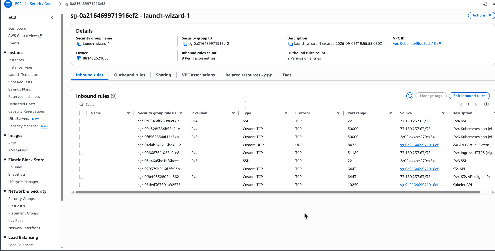
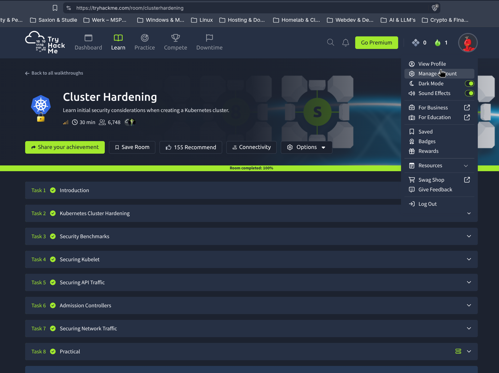

# Week 5

## 5.1 kube-bench: baseline en drie Level 2-maatregelen

Baseline op CN1 (control plane), met de k3s-specifieke benchmark van kube-bench:

```
$ sudo ./kube-bench run --config-dir ./cfg
== Summary total ==
54 checks PASS, 5 checks FAIL, 57 checks WARN, 14 checks INFO
```

Van de 5 FAIL's waren er geen Level 2 (allemaal Level 1: PKI-bestandsrechten, een paar RBAC-punten). Voor de opdracht heb ik drie Level 2-maatregelen uit drie verschillende control-families toegepast:

**Family 5.7 (General Policies), al aanwezig sinds week 2.** 5.7.2 (seccomp-profiel verplicht) en 5.7.3 (SecurityContext op pods) staan al in [kubernetes/deployment.yaml](../kubernetes/deployment.yaml) sinds de Snyk IaC-fixes in week 2 (2.2, fix 6): `seccompProfile: RuntimeDefault`, `runAsNonRoot`, capabilities drop, `allowPrivilegeEscalation: false`. kube-bench blijft dit als WARN melden omdat het een "Manual"-check is (vereist menselijke beoordeling van de pod-spec), maar de instelling staat er al.

**Family 5.2 (Pod Security Standards), nieuw.** De `default`-namespace afgedwongen op het "restricted" Pod Security-niveau:

```
$ kubectl label namespace default pod-security.kubernetes.io/enforce=restricted pod-security.kubernetes.io/enforce-version=latest
namespace/default labeled
```

De bestaande pod bleef gewoon draaien (die voldeed al, zie hierboven). Een bewust onveilige test-pod werd meteen geweigerd:

```
$ kubectl run privtest --image=busybox --restart=Never --privileged --command -- sleep 60
Error from server (Forbidden): pods "privtest" is forbidden: violates PodSecurity "restricted:latest":
privileged (container "privtest" must not set securityContext.privileged=true),
allowPrivilegeEscalation != false, unrestricted capabilities, runAsNonRoot != true,
seccompProfile (must set securityContext.seccompProfile.type to "RuntimeDefault" or "Localhost")
```

**Family 3.2 (Audit Logging), nieuw.** K3s logde standaard niets van de API-server. Via [kubernetes/audit-policy.yaml](../kubernetes/audit-policy.yaml) en een `/etc/rancher/k3s/config.yaml` met `kube-apiserver-arg` heb ik audit logging aangezet. Het beleid let juist op de interessante dingen: `pods/exec`/`attach` en RBAC-wijzigingen volledig (`RequestResponse`), secrets/configmaps alleen op metadata-niveau (geen waardes in het logbestand zelf), de rest op metadata-niveau. Na `systemctl restart k3s` bleef het cluster Ready, geen downtime van de app:

```
$ kubectl exec deploy/devops-security -- id          # pods/exec -> RequestResponse, incl. responseObject
$ kubectl get secret regcred                          # secrets -> Metadata, GEEN requestObject/responseObject
```

Opnieuw gedraaid na de fixes:

```
== Summary total ==
59 checks PASS, 5 checks FAIL, 52 checks WARN, 14 checks INFO
```

Vijf bevindingen gingen van WARN naar PASS: `1.2.16/17/18/19` (audit-log-path, -maxage, -maxbackup, -maxsize) en `3.2.1` (minimaal auditbeleid aanwezig). `3.2.2` zelf blijft WARN omdat kube-bench die altijd handmatig laat beoordelen, maar de twee commando's hierboven laten zien dat het beleid daadwerkelijk doet wat het moet doen.

**Containerd-maatregel zonder CIS-controle.** De CIS Kubernetes Benchmark zegt niets over de rechten op de containerd-socket zelf (`/run/k3s/containerd/containerd.sock`). Wie dat socket kan aanspreken, kan containers starten en stoppen met root-rechten op de node: een bekend escalatiepad dat de NSA/CISA Kubernetes Hardening Guidance wel noemt. Gecontroleerd dat die socket niet wereld-toegankelijk is:

```
$ ls -la /run/k3s/containerd/containerd.sock
srw-rw---- 1 root root 0 Nov  1 17:07 /run/k3s/containerd/containerd.sock
```

Stond al goed (alleen root/root-group), dus hier was niets te fixen, maar wel de moeite van het checken waard: een wereld-schrijfbare containerd-socket zou verslaan wat de RBAC- en PodSecurity-maatregelen hierboven juist proberen te voorkomen.

**Bronnen**

- Center for Internet Security. (z.d.). *CIS Kubernetes Benchmark v1.8.0*. [https://www.cisecurity.org/benchmark/kubernetes](https://www.cisecurity.org/benchmark/kubernetes)
- Aqua Security. (z.d.). *kube-bench*. GitHub. [https://github.com/aquasecurity/kube-bench](https://github.com/aquasecurity/kube-bench)
- The Kubernetes Authors. (z.d.). *Pod Security Standards*. [https://kubernetes.io/docs/concepts/security/pod-security-standards/](https://kubernetes.io/docs/concepts/security/pod-security-standards/)
- The Kubernetes Authors. (z.d.). *Auditing*. [https://kubernetes.io/docs/tasks/debug/debug-cluster/audit/](https://kubernetes.io/docs/tasks/debug/debug-cluster/audit/)
- National Security Agency & Cybersecurity and Infrastructure Security Agency. (2022). *Kubernetes hardening guidance* (v1.2). [https://media.defense.gov/2022/Aug/29/2003066362/-1/-1/0/CTR_KUBERNETES_HARDENING_GUIDANCE_1.2_20220829.PDF](https://media.defense.gov/2022/Aug/29/2003066362/-1/-1/0/CTR_KUBERNETES_HARDENING_GUIDANCE_1.2_20220829.PDF)

## 5.2 Ingress met TLS-terminatie, op een niet-443-poort

K3s heeft Traefik al ingebouwd als Ingress-controller (`kubectl get ingressclass` toont `traefik (default)`). ServiceLB, de eigen load-balancer-simulatie van K3s voor bare-metal clusters, zet de Traefik-service standaard op een `LoadBalancer` met een willekeurige NodePort per poort: 80 op 31985 en 443 op 31189. Een aparte ingress-nginx installeren was dus niet nodig en had alleen extra geheugen gekost op een toch al kleine `t2.medium`.

Ik heb een self-signed certificaat gemaakt en als TLS-secret gezet, en daarna de Ingress toegepast ([kubernetes/ingress.yaml](../kubernetes/ingress.yaml)):

```bash
openssl req -x509 -nodes -days 365 -newkey rsa:2048 -keyout tls.key -out tls.crt -subj "/CN=quoterxp.local"
kubectl create secret tls quoterxp-tls --key tls.key --cert tls.crt
kubectl apply -f kubernetes/ingress.yaml
```

Getest op de HTTPS-NodePort (31189, dus niet 443) op CN1 zelf:

```
$ curl -skv --resolve quoterxp.local:31189:127.0.0.1 https://quoterxp.local:31189/
* SSL connection using TLSv1.3 / TLS_AES_128_GCM_SHA256 / X25519MLKEM768 / RSASSA-PSS
*   subject: CN=quoterxp.local
* using HTTP/2
> GET / HTTP/2
< HTTP/2 200
```

Traefik doet hier de TLS-terminatie (SSL-offloading): de verbinding van buiten is versleuteld tot aan Traefik, en van Traefik naar de pod gaat het gewoon via HTTP op poort 5000 binnen het cluster.

Om dit ook echt van buiten het cluster te testen, moest de security group eerst een regel voor 31189 krijgen. Daarbij viel op dat NodePort 30000 (de app uit week 1) op dat moment vanaf `0.0.0.0/0` en `::/0` open stond, niet alleen vanaf mijn eigen IP zoals ik in week-1/README.md had opgeschreven. Beide dingen in één keer rechtgezet: 30000 verkrapt naar mijn eigen IP, net als bij SSH, en nieuwe regels voor 31189 en 6443 toegevoegd, ook allebei alleen voor mijn eigen IP. De self-reference op 6443 (voor CN1↔CN2 onderling) blijft gewoon staan, de nieuwe regel komt ernaast.



Daarna rechtstreeks vanaf mijn eigen laptop getest (niet meer via SSH):

```
$ curl -sk -o /dev/null -w 'HTTP %{http_code}\n' --resolve quoterxp.local:31189:13.222.169.74 https://quoterxp.local:31189/
HTTP 200
```

## 5.3 Welke CNI gebruikt K3s, en is dat veilig genoeg?

K3s gebruikt standaard Flannel als CNI, met VXLAN als backend (zie ook de dual-stack VXLAN-regel in de security group, [week-1/README.md](../week-1/README.md#11-bootomgeving)). Flannel zelf regelt alleen de overlay (routing tussen pods op verschillende nodes), geen policy-afdwinging. K3s bundelt daarnaast een eigen, op kube-router gebaseerde network-policy-controller die los van Flannel draait en `NetworkPolicy`-objecten wel degelijk afdwingt, tenzij je K3s start met `--disable-network-policy`. Dat is bij mijn cluster niet gezet, dus de NetworkPolicy uit 5.3 hoort hier echt effect te hebben: dat bewijs ik hieronder zodra het cluster weer aanstaat.

CNI vervangen kan, maar niet live: K3s start Flannel bij de eerste `k3s server`-aanroep, dus om een andere CNI te gebruiken moet je het cluster met `--flannel-backend=none` opnieuw opzetten en zelf een CNI installeren (Calico, Canal of Cilium). Canal (Flannel + Calico samen) of Calico alleen geven uitgebreidere policy-opties dan de kube-router-controller van K3s, zoals policies op basis van namespaces met labels in plaats van alleen CIDR's, en egress-filtering naar externe IP's. Cilium gaat nog verder met L7-policies (bijvoorbeeld: deze pod mag alleen een specifiek HTTP-pad benaderen, niet zomaar alle verkeer naar een poort) en eBPF in plaats van iptables, wat beter schaalt bij veel nodes.

Voor een cluster van deze omvang (twee nodes) is de ingebouwde policy-controller van K3s voldoende: die dekt de NetworkPolicy hieronder gewoon. Bij een groter cluster met meerdere teams en namespaces zou ik Cilium adviseren, vooral om de L7-policies en de eBPF-gebaseerde observability (Hubble) die erbij komt.

**Bronnen**

- SUSE / Rancher Labs. (z.d.). *K3s networking options*. [https://docs.k3s.io/networking](https://docs.k3s.io/networking)
- flannel-io. (z.d.). *Flannel* [broncode]. GitHub. [https://github.com/flannel-io/flannel](https://github.com/flannel-io/flannel)
- Isovalent / Cilium. (z.d.). *CNI chaining*. [https://docs.cilium.io/en/stable/installation/cni-chaining/](https://docs.cilium.io/en/stable/installation/cni-chaining/)

### NetworkPolicy: alleen poort 5000

[kubernetes/networkpolicy.yaml](../kubernetes/networkpolicy.yaml) selecteert de `quoterxp`-pods en staat alleen inkomend verkeer op poort 5000 toe. Zodra een pod door een NetworkPolicy geselecteerd wordt, geldt voor die pod: wat niet expliciet toegestaan is, wordt geblokkeerd.

```
$ kubectl apply -f kubernetes/networkpolicy.yaml
networkpolicy.networking.k8s.io/quoterxp-allow-5000-only created

$ kubectl run nptest --rm -i --restart=Never --image=busybox --command -- sh -c 'nc -zv -w3 devops-security 5000'
devops-security (10.43.166.211:5000) open

$ kubectl run nptest --rm -i --restart=Never --image=busybox --command -- sh -c 'nc -zv -w3 devops-security 9999'
nc: devops-security (10.43.166.211:9999): Connection timed out
```

Dit bevestigt ook meteen het antwoord hierboven: de ingebouwde policy-controller van K3s dwingt de NetworkPolicy echt af, ook al is Flannel zelf alleen een overlay-netwerk.

## 5.4 Toegang zonder adminwachtwoord

SolidApps zou de omgeving met Terraform/Ansible uitrollen in plaats van losse scripts zoals in deze PoC. Zo zou ik de toegang daarbij regelen, zonder gedeeld adminwachtwoord.

Voor SSH gewoon een los sleutelpaar per engineer, geen gedeelde `admin`-login. Op AWS is EC2 Instance Connect of SSM Session Manager eigenlijk nog beter: dan hoeft er helemaal geen SSH-poort open te staan en geen sleutel rondgestuurd te worden, AWS regelt de toegang dan via IAM.

Voor Terraform remote state in een S3-bucket, met een bucket policy die alleen de juiste IAM-rol lees/schrijftoegang geeft, want die state kan secrets bevatten zoals wachtwoorden in `terraform.tfvars`. De pipeline die `terraform apply` draait authenticeert dan met een IAM-rol via OIDC vanuit GitHub Actions, dus met een kortlevend token in plaats van een permanente access key in een secret.

Ansible-inventory en playbooks gebruiken sleutels, geen wachtwoorden, en secrets in playbooks (zoals API-sleutels) staan versleuteld met `ansible-vault`, nooit in platte tekst in de repository.

En op de nodes zelf: elke engineer een eigen account met een eigen sleutel, sudo-rechten gelogd per gebruiker met `auditd`, in plaats van iedereen via hetzelfde `root`- of `admin`-wachtwoord.

Dit is hetzelfde idee als mijn advies in 2.3 en 4.3: een centrale identiteit (IAM-rol, Entra ID of een eigen sleutel) in plaats van een gedeeld geheim dat overal hetzelfde blijft en bij een lek overal opnieuw moet.

De TryHackMe-room "Cluster Hardening" doorlopen (100%, alle 8 taken, inclusief de praktische opdracht):



De drie belangrijkste hardeningspunten uit de room, voor SolidApps:

1. **TLS op al het verkeer tussen de control-plane-componenten.** De kube-apiserver praat met zo ongeveer alles in het cluster (kubelet, etcd, zichzelf vanuit andere pods), en is daarbij zowel server als client. Staat dat verkeer niet versleuteld, dan kan iemand die al ergens in het netwerk zit meekijken of zich voordoen als een van die componenten. CIS-controls 1.2.24 t/m 1.2.27 gaan hier precies over.
2. **RBAC met least privilege**, zoals ik in 7.2 ook toepas: geen brede rechten aan een service-account geven "voor het geval dat", maar precies het stukje dat nodig is. Een gekaapte pod met te veel rechten kan zo het hele cluster overnemen in plaats van alleen zichzelf.
3. **Admission Controllers.** In gewone-mensen-taal: een soort portier bij de deur van het cluster. Voordat een pod mag starten, checkt die portier eerst of de pod aan de regels voldoet (bijvoorbeeld: niet als root, geen privileged mode). Voldoet de pod niet, dan mag hij het cluster niet eens in. Niet "we zien het later wel of hij iets kapot maakt", maar hij start gewoon niet. Precies wat ik in 5.1 al in actie zag: de bewust onveilige test-pod (`privileged: true`) werd door Kubernetes' eigen Pod Security Admission geweigerd nog vóórdat hij kon draaien.
