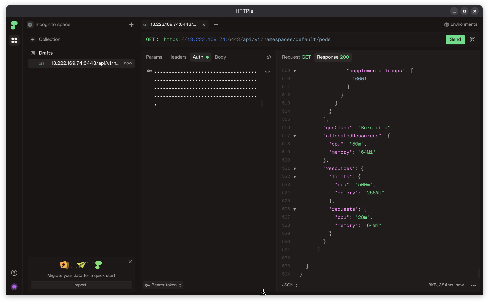
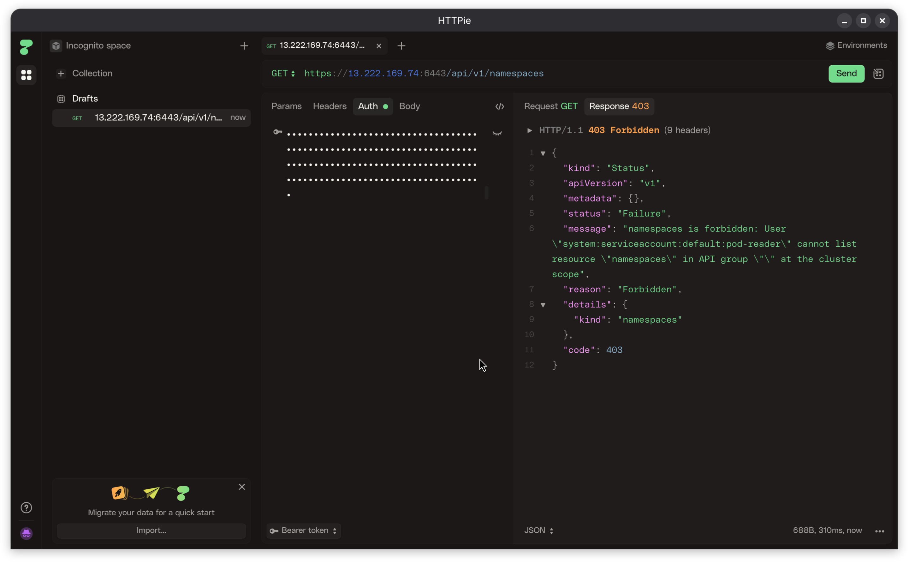

# Week 7

## 7.1 OS-hardening op CN1 en CN2

De nodes draaien Ubuntu 26.04 LTS, dus de CIS Ubuntu Linux Benchmark is van toepassing (zie `school docs/Week7/`). Ik heb drie Level 2-maatregelen toegepast, uit drie verschillende control-families, op beide nodes.

Eerst de ongebruikte filesystem-kernelmodules uitgeschakeld (CIS 1.1.x, bestandssystemen). `cramfs` en `udf` gebruik ik op deze VM's toch niet, en een kwetsbaarheid in zo'n weinig gebruikte module is een onnodig aanvalsoppervlak.

```bash
echo "install cramfs /bin/false" | sudo tee /etc/modprobe.d/cramfs.conf
echo "install udf /bin/false"    | sudo tee /etc/modprobe.d/udf.conf
```

Daarna auditd aangezet, met een regel op wijzigingen aan `/etc/sudoers` (CIS 4.1.x, logging en auditing):

```bash
sudo apt-get install -y auditd audispd-plugins
echo "-w /etc/sudoers -p wa -k sudoers_wijziging" | sudo tee /etc/audit/rules.d/50-sudoers.rules
sudo systemctl enable --now auditd
```

Getest met een `chmod` op `/etc/sudoers` (geen inhoud veranderd, alleen om de regel te triggeren):

```
$ sudo chmod 440 /etc/sudoers
$ sudo grep sudoers_wijziging /var/log/audit/audit.log | tail -1
type=SYSCALL msg=audit(1793553120.409:461): ... comm="chmod" ... key="sudoers_wijziging" ... AUID="ubuntu" UID="root"
```

En tot slot sshd gehard (CIS 5.1.x, SSH): root-login uit en maximaal 4 inlogpogingen per verbinding.

```bash
sudo sed -i 's/^#\?PermitRootLogin.*/PermitRootLogin no/' /etc/ssh/sshd_config
sudo sed -i 's/^#\?MaxAuthTries.*/MaxAuthTries 4/' /etc/ssh/sshd_config
sudo systemctl reload sshd
```

Controle na alle drie de maatregelen, op beide nodes: een nieuwe SSH-sessie moest nog lukken (niet de bestaande sessie hergebruiken, anders zie je een eventuele lock-out niet) en het cluster moest Ready blijven:

```
$ ssh ubuntu@<cn2-ip> whoami
ubuntu
$ kubectl get nodes
NAME   STATUS   ROLES           VERSION
cn1    Ready    control-plane   v1.37.0+k3s1
cn2    Ready    <none>          v1.37.0+k3s1
```

**Bronnen**

- Center for Internet Security. (z.d.). *CIS Ubuntu Linux 22.04 LTS Benchmark* (v1.0.0). [../school docs/Week7/CIS_Ubuntu_Linux_22.04_LTS_Benchmark_v1.0.0.pdf](../school%20docs/Week7/CIS_Ubuntu_Linux_22.04_LTS_Benchmark_v1.0.0.pdf)
- Canonical. (z.d.). *modprobe.d(5) – Ubuntu manpages*. [https://manpages.ubuntu.com/manpages/noble/man5/modprobe.d.5.html](https://manpages.ubuntu.com/manpages/noble/man5/modprobe.d.5.html)
- Boelen, M. (z.d.). *Auditd*. Linux Audit. [https://linux-audit.com/auditd/](https://linux-audit.com/auditd/)
- OpenBSD Project. (z.d.). *sshd_config(5)*. [https://man.openbsd.org/sshd_config](https://man.openbsd.org/sshd_config)

## 7.2 ServiceAccount met least-privilege RBAC

[kubernetes/pod-reader-rbac.yaml](../kubernetes/pod-reader-rbac.yaml) maakt een ServiceAccount `pod-reader` met een ClusterRole die alleen `get`/`list` op `pods` toestaat, niets anders:

```bash
kubectl apply -f kubernetes/pod-reader-rbac.yaml
TOKEN=$(kubectl create token pod-reader --duration=24h)
```

Eerst met curl vanaf CN1 zelf getest (snelle controle, pods opvragen werkt):

```
$ curl -sk -H "Authorization: Bearer $TOKEN" https://127.0.0.1:6443/api/v1/namespaces/default/pods -o resp.json -w 'HTTP %{http_code}\n'
HTTP 200
$ python3 -c "import json; print([p['metadata']['name'] for p in json.load(open('resp.json'))['items']])"
['devops-security-6fdcbf5c57-fhbvf']
```

Voor het echte bewijs gebruik ik HTTPie in plaats van Postman: Postman is een steeds zwaarder, "enterprise"-achtig product geworden, HTTPie Desktop doet hetzelfde en is simpeler. Zelfde bearer-token, nu rechtstreeks vanaf mijn eigen laptop (de security group staat inmiddels ook mijn eigen IP toe op 6443, zie week-5). HTTPie waarschuwt eerst dat het cluster-certificaat self-signed is; dat accepteer ik, net als `curl -k` dat negeert.

Pods opvragen (toegestaan): HTTP 200, met het volledige pod-object als JSON terug.



Namespaces opvragen (niet in de ClusterRole): een harde 403, geen gedeeltelijk antwoord.



```json
{
  "status": "Failure",
  "message": "namespaces is forbidden: User \"system:serviceaccount:default:pod-reader\" cannot list resource \"namespaces\" in API group \"\" at the cluster scope",
  "reason": "Forbidden",
  "code": 403
}
```

## 7.3 Een toekomstige Windows worker-node hardenen

Mocht SolidApps ooit Windows-containers nodig hebben (bijvoorbeeld voor een .NET Framework-applicatie die niet naar .NET (Core) overgezet kan worden), dan komt daar een Windows worker-node bij. Kubernetes ondersteunt dat met containerd en een Windows-versie van de kubelet, maar het blijft een aparte besturingssysteem-familie met een eigen benchmark.

Hardeningsmaatregelen die ik zou toepassen: de CIS Benchmark for Microsoft Windows Server in plaats van de Ubuntu-benchmark uit 7.1, bijvoorbeeld via Microsoft's eigen Security Compliance Toolkit of Group Policy, in lijn met hoe 7.1 dat voor Linux doet. Lokale beheerderswachtwoorden uniek maken en laten rouleren met LAPS, zodat niet elke node hetzelfde lokale adminwachtwoord deelt. SMBv1 uit en de Windows Defender Exploit Guard-regels aan: SMBv1 is de default-aanvalsvector van onder andere WannaCry en hoeft op een Kubernetes-node niet aan te staan. De firewall net zo minimaal als de security group in 1.1, dus alleen de kubelet-poort (10250) en het NodePort-bereik open, verder dicht. Voor Active Directory-toegang vanuit containers group Managed Service Accounts (gMSA) gebruiken in plaats van wachtwoorden erin te zetten, net zoals de Linux-kant secrets runtime injecteert (zie 4.4) in plaats van ze ergens neer te zetten. En een patchbeleid: Windows Update op een vast schema, ring-gewijs uitgerold in plaats van meteen clusterbreed, met dezelfde CVE-opvolging als in 1.3.

**Bronnen**

- Center for Internet Security. (z.d.). *CIS Microsoft Windows Server Benchmarks*. [https://www.cisecurity.org/benchmark/microsoft_windows_server](https://www.cisecurity.org/benchmark/microsoft_windows_server)
- Microsoft. (z.d.). *Harden Windows containers*. [https://learn.microsoft.com/en-us/virtualization/windowscontainers/manage-containers/container-security](https://learn.microsoft.com/en-us/virtualization/windowscontainers/manage-containers/container-security)
- The Kubernetes Authors. (z.d.). *Windows in Kubernetes*. [https://kubernetes.io/docs/concepts/windows/intro/](https://kubernetes.io/docs/concepts/windows/intro/)
- Microsoft. (z.d.). *Local Administrator Password Solution (LAPS)*. [https://learn.microsoft.com/en-us/windows-server/identity/laps/laps-overview](https://learn.microsoft.com/en-us/windows-server/identity/laps/laps-overview)
- The Kubernetes Authors. (z.d.). *Configure GMSA for Windows pods and containers*. [https://kubernetes.io/docs/tasks/configure-pod-container/configure-gmsa/](https://kubernetes.io/docs/tasks/configure-pod-container/configure-gmsa/)
